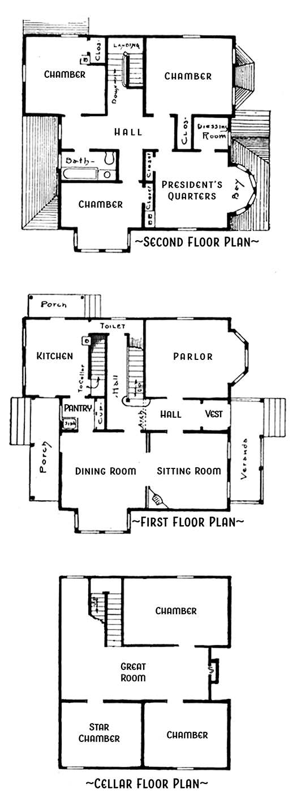

снимки, тайком сделанные во время слежки за аспирантом без его ведома.

**Площадка Вестингауза.** Люк в потолке Покоев президента ведёт на эту маленькую открытую площадку на крыше дома братства. Площадка вмещает не больше четырёх взрослых. К перилам вокруг площадки прикреплён железный громоотвод высотой 8 футов (около 2,4 м). Именно на этой площадке умер Вестингауз. Верхушка громоотвода украшена звездой братства.

**Спальни.** Каждая из этих комнат рассчитана на четверых. В каждой две двухъярусные кровати и небольшой письменный стол. Ни в одной из этих комнат нет улик, важных для сценария. По усмотрению Хранителя при успешной проверке **Внимания** аспирант может найти здесь подручное оружие.

### Комнаты подвала

**Большой зал.** На полу этой комнаты нарисована звезда братства КДП. Зал заставлен складными стульями. Под лестницей есть небольшая кладовка; в ней коробка с двадцатью белыми балахонами и одним золотистым. На спине у всех балахонов вышита звезда братства КДП. Там же другая коробка — с шестью парами наручников и набором зловещих на вид ножей.

В углу у лестницы стоит большой котёл отопления, а на стене рядом с парой спален висит мишень для дартса. Мишень скрывает небольшой сейф в стене. В сейфе заперта подлинная рукопись Вестингауза — «Искра жизни». Чтобы открыть сейф, нужна успешная проверка **Взлома**.

**Звёздная палата.** Эта комната — сердце культа Ксейруу’ка в Каппа Дельта Пси. Здесь стоит толстый круглый дубовый стол, на котором вырезана звезда братства КДП. К столу на равном расстоянии друг от друга привинчены несколько железных колец. Вокруг

**Подписи на плане**

| На плане | Перевод |
|---|---|
| Second Floor Plan | План второго этажа |
| First Floor Plan | План первого этажа |
| Cellar Floor Plan | План подвала |
| Chamber | Спальня |
| Hall | Холл (на первом этаже у кухни — проход) |
| President’s Quarters | Покои президента |
| Bay | Эркер |
| Dressing Room | Гардеробная |
| Bath | Ванная |
| Clos. / Closet | Стенной шкаф |
| Landing | Лестничная площадка |
| Down / Up | Лестница вниз / вверх |
| To Cellar | Лестница в подвал |
| Kitchen | Кухня |
| Pantry | Кладовая |
| Cup. | Буфет |
| Sink | Мойка |
| Toilet | Уборная |
| Porch | Крыльцо (заднее и боковое) |
| Parlor | Гостиная |
| Arch | Арка |
| Vest | Вестибюль |
| Veranda | Веранда |
| Dining Room | Столовая |
| Sitting Room | Малая гостиная |
| Great Room | Большой зал |
| Star Chamber | Звёздная палата |
| S | Значок у стены Большого зала |

*Прим. перев.: буква «S» у стены Большого зала на плане в тексте не объяснена — возможно, это сейф за мишенью для дартса.*

> ### «Искра жизни»
>
> *Английский язык, Корнелиус Вестингауз, 1820 год*
>
> Книга в кожаном переплёте, 10 × 12,5 дюйма (около 25 × 32 см); Вестингауз заказал её печатнику Мискатоникского университета в единственном экземпляре. «Искра жизни» — манифест даров Ксейруу’ка и поклонения ему. В ней же — тайны планеты Сатурн и её коренного народа (сами жители, идхеемцы, зовут Сатурн Цикраношем).
>
> - **Потеря Рассудка:** 1d6
> - **Мифы Ктулху:** +2% за беглый просмотр / +4% за полное прочтение
> - **Значение Мифов:** 12
> - **Изучение:** 20 недель
> - **Предлагаемые заклинания:** «Накормить Искру Жизни» (*Вызов / Изгнание Ксейруу’ка*), «Беседа с Багровой бурей» (*Связь с божеством: Ксейруу’к*), «Дыхание бессмертия» (*Распределение ка*), «Ласка Ксейруу’ка» (*Заклятие смерти*, вариант с электрическим уроном вместо огня), «Одеяние чужой плоти» (*Обмен разумом*) и «Обряд солей» (*Воскрешение*).
