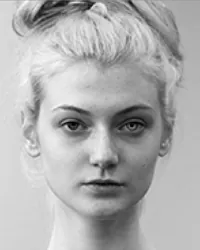

## Рут Пизли

*Лицевая сторона стандартного листа сыщика 1920-х годов «Call of Cthulhu»; в правом верхнем углу — портрет. Ниже — перевод заполненных полей.*

| Сыщик 1920-х | |
|---|---|
| Имя | Рут Пизли |
| Игрок | — (пусто) |
| Профессия | аспирантка-юрист Мискатоникского университета |
| Возраст | 26 |
| Пол | женский |
| Место жительства | Аркхэм, Массачусетс |
| Место рождения | Хартфорд, Коннектикут |

**Характеристики**

| Характеристика | Значение | ½ | ⅕ |
|---|---|---|---|
| СИЛ | 40 | 20 | 8 |
| ВЫН | 50 | 25 | 10 |
| ТЕЛ | 45 | 22 | 9 |
| ЛВК | 60 | 30 | 12 |
| НАР | 65 | 32 | 13 |
| ИНТ (Идея) | 55 | 27 | 11 |
| МОЩ | 50 | 25 | 10 |
| ОБР | 70 | 35 | 14 |

| Производные | |
|---|---|
| Пункты здоровья | 9 |
| Пункты магии | 10 |
| Рассудок | 50 (максимум не указан) |
| Удача | не указана — игрок бросает 2d6+6 × 5 (с. 11) |
| СКО | 8 |
| Бонус к урону | нет |
| Комплекция | 0 |
| Уклонение | 30% (15/6) |

**Навыки сыщика** (заполненные на листе; остальные — с базовыми значениями бланка)

| Навык | Значение | ½ | ⅕ |
|---|---|---|---|
| Ближний бой (драка) | 25% | 12 | 5 |
| Внимание | 45% | 22 | 9 |
| Вождение автомобиля | 40% | 20 | 8 |
| Иностранный язык (латынь) | 31% | 15 | 6 |
| Искусство/ремесло (фотография) | 45% | 22 | 9 |
| История | 45% | 22 | 9 |
| Красноречие | 35% | 17 | 7 |
| Обаяние | 45% | 22 | 9 |
| Право | 55% | 27 | 11 |
| Психология | 45% | 22 | 9 |
| Работа в библиотеке | 50% | 25 | 10 |
| Родной язык (английский) | 70% | 35 | 14 |
| Слух | 40% | 20 | 8 |
| Средства | 10% | 5 | 2 |
| Убеждение | 45% | 22 | 9 |
| Уклонение | 30% | 15 | 6 |

**Оружие**

| Оружие | Обычный | Трудный | Чрезвычайный | Урон | Дальность | Атак | Боезапас | Осечка |
|---|---|---|---|---|---|---|---|---|
| Без оружия | 25 | 12 | 5 | 1d3 + БкУ | — | 1 | — | — |

**Бой:** бонус к урону — нет; Комплекция — 0; Уклонение — 30 (15/6).
