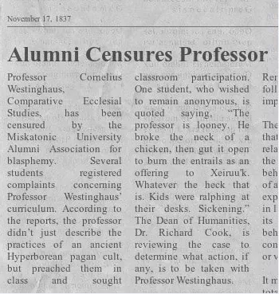
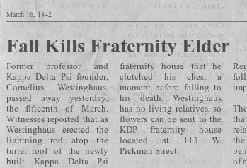

## Раздатка «Искра жизни» 2

> **Раздатка «Искра жизни» 2**
>
> *17 ноября 1837 года*
>
> **ВЫПУСКНИКИ ОСУДИЛИ ПРОФЕССОРА**
>
> Профессор Корнелиус Вестингауз (сравнительная экклезиология) осуждён Ассоциацией выпускников Мискатоникского университета за богохульство. Несколько студентов подали жалобы на учебную программу профессора Вестингауза. Согласно жалобам, профессор не просто описывал обряды древнего гиперборейского языческого культа, но проповедовал их на занятиях и добивался участия всего класса. Один студент, пожелавший остаться неизвестным, говорит: «Профессор чокнутый. Он свернул шею курице, потом вспорол её и сжёг потроха в жертву Ксейруу’ку. Что бы это ни значило. Ребят прямо за партами выворачивало. Мерзость». Декан гуманитарного факультета доктор Ричард Кук рассматривает дело, чтобы решить, какие меры, если они нужны, принять в отношении профессора Вестингауза.

## Раздатка «Искра жизни» 3

> **Раздатка «Искра жизни» 3**
>
> *16 марта 1842 года*
>
> **ПАДЕНИЕ УБИЛО СТАРЕЙШИНУ БРАТСТВА**
>
> Бывший профессор и основатель Каппа Дельта Пси Корнелиус Вестингауз скончался вчера, пятнадцатого марта. По словам свидетелей, когда Вестингауз устанавливал громоотвод на крыше башенки только что построенного дома братства Каппа Дельта Пси, он схватился за грудь и через мгновение упал и разбился насмерть. Живых родственников у Вестингауза нет, поэтому цветы можно присылать в дом братства КДП на Уэст-Пикман-стрит, 113.

*На вырезках справа видны обрывки соседних колонок газеты — неразборчиво. Фото, о которых говорит текст сценария (с. 5), в раздатках не напечатаны.*
