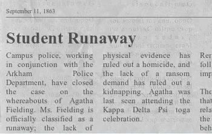
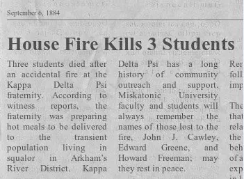

## Раздатка «Искра жизни» 4

> **Раздатка «Искра жизни» 4**
>
> *11 сентября 1863 года*
>
> **СТУДЕНТКА СБЕЖАЛА**
>
> Полиция кампуса совместно с полицией Аркхэма закрыла дело об исчезновении Агаты Филдинг. Мисс Филдинг официально признана сбежавшей: отсутствие вещественных доказательств исключает убийство, а отсутствие требования выкупа — похищение. В последний раз Агату видели на празднике Каппа Дельта Пси в тогах.

## Раздатка «Искра жизни» 5

> **Раздатка «Искра жизни» 5**
>
> *6 сентября 1884 года*
>
> **ПОЖАР В ДОМЕ УНЁС ЖИЗНИ ТРЁХ СТУДЕНТОВ**
>
> Три студента погибли при случайном пожаре в братстве Каппа Дельта Пси. По словам свидетелей, братство готовило горячую еду, чтобы раздать её бездомным, живущим в нищете в Речном районе Аркхэма. У Каппа Дельта Пси давняя история помощи и поддержки общине. Преподаватели и студенты Мискатоникского университета навсегда запомнят имена погибших в огне — Джона Дж. Коули, Эдварда Грина и Говарда Фримена; да покоятся они с миром.
