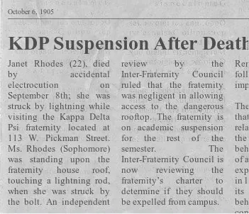
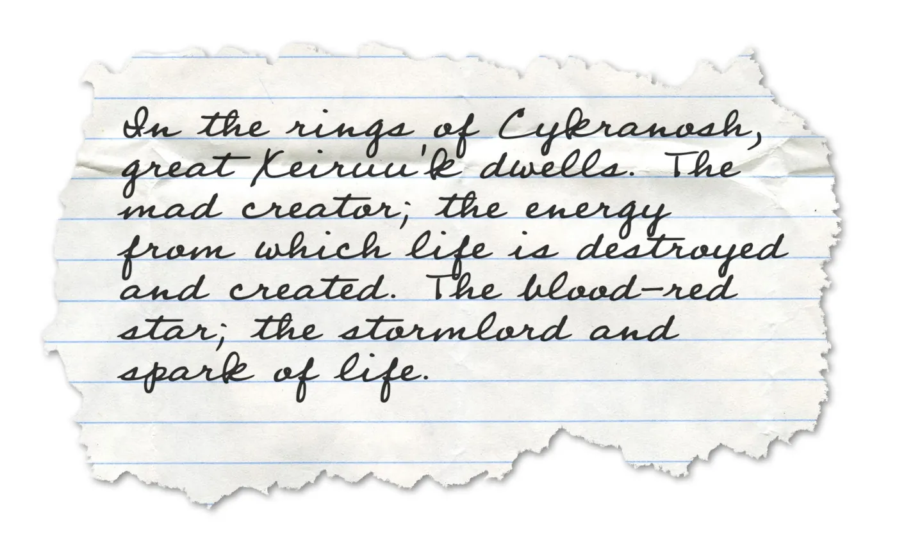

## Раздатка «Искра жизни» 6

> **Раздатка «Искра жизни» 6**
>
> *6 октября 1905 года*
>
> **КДП ОТСТРАНЕНО ПОСЛЕ ГИБЕЛИ СТУДЕНТКИ**
>
> Джанет Роудс (22) погибла 8 сентября от случайного удара током: в неё ударила молния, когда она была в гостях в братстве Каппа Дельта Пси на Уэст-Пикман-стрит, 113. Мисс Роудс (второкурсница) стояла на крыше дома братства, касаясь громоотвода, когда в неё ударила молния. Независимая проверка Совета братств постановила, что братство проявило небрежность, допустив её на опасную крышу. Братство отстранено от учёбы до конца семестра. Совет братств пересматривает устав братства, чтобы решить, не исключить ли его из кампуса.

## Раздатка «Искра жизни» 7

> **Раздатка «Искра жизни» 7**
>
> *Клочок линованной бумаги, от руки:*
>
> *В кольцах Цикраноша обитает великий Ксейруу’к. Безумный творец; энергия, из которой жизнь уничтожается и создаётся. Кроваво-красная звезда; повелитель бурь и искра жизни.*
