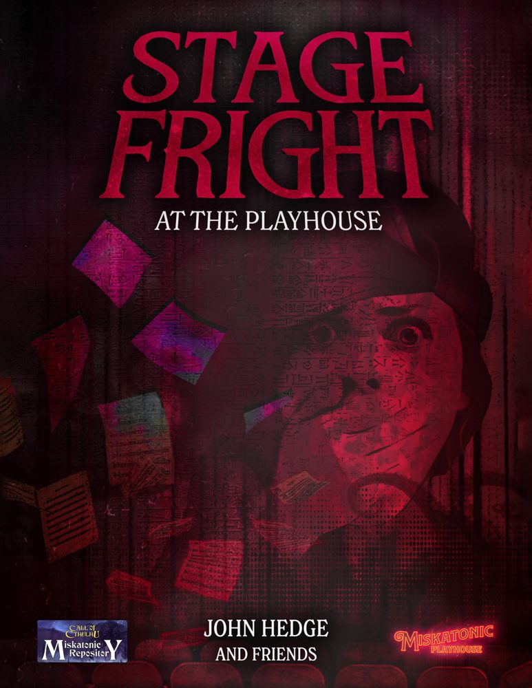

ИСПУГ НА СЦЕНЕ

Джон Хедж и друзья

*На обложке — лицо женщины с широко раскрытыми глазами в багровом свете театрального занавеса; лицо покрыто клинописными знаками, вокруг кружатся листы с письменами. Название — «Stage Fright at the Playhouse» («Испуг на сцене»), внизу — имя автора (John Hedge and Friends), логотипы «Call of Cthulhu — Miskatonic Repository» и «Miskatonic Playhouse».*
