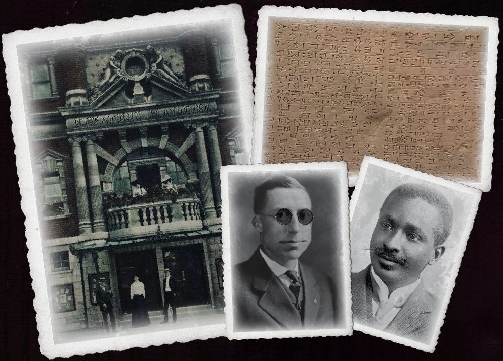

Таинственные символы неведомого языка будто бы за одну ночь появились на фасаде обветшалого театра в Аркхэме. Но какие гнусные замыслы на самом деле зреют за кулисами Мискатоникского театра?

**«Испуг на сцене»** — продолжение сценария *«Грань тьмы»* (из *«Стартового набора» «Зова Ктулху»* от Chaosium), но его можно сыграть и как отдельное приключение. Сценарий рассчитан на трёх–пятерых игроков и займёт одну-две сессии (3–8 часов).

- Сценарий написан для 7-й редакции «Зова Ктулху» и содержит:
    - сценарий для игроков любого опыта;
    - полноцветные раздатки и карты;
    - пятерых готовых сыщиков;
    - новую книгу Мифов;
    - дополнительную версию для печати.

*Прим. перев.: в этом PDF версии для печати нет.*

Сценарий написан для конкурса The Next Adventure Design Jam, который проводил DriveThruRPG.

*Справа от текста — эмблема: багровый силуэт служителя Внешних богов среди клинописных знаков.*
