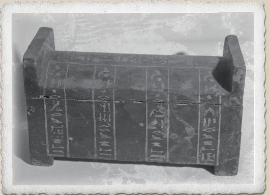
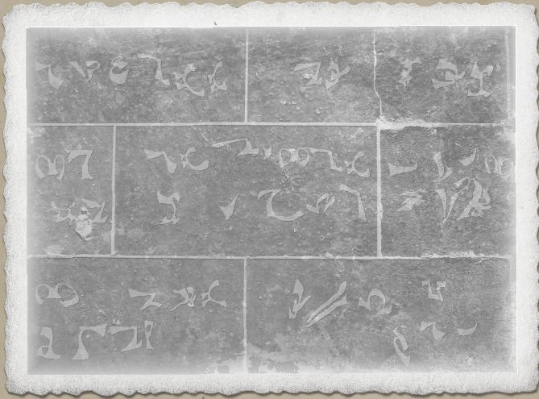

## Как вовлечь сыщиков

Сценарий задуман как часть кампании, продолжающей события «Грани тьмы». Сыщики хотят расшифровать некий древний язык, найденный ими на египетской шкатулке. В этом сценарии считается, что древний язык — разновидность языка, родившегося на затерянном континенте Му. Впрочем, его можно заменить любым другим древним языком на выбор Хранителя.

В начале сценария сыщики либо слышат от знакомого, либо видят сами странные символы, нацарапанные на стенах Мискатоникского театра вокруг главных дверей. Сыщики понимают, что эти символы поразительно похожи на те, что они изучают, и что театр может хранить ключ к расшифровке этого языка.

> ### Альтернативная завязка: просьба учёного
>
> Возможно, вы решили провести этот сценарий, не сыграв перед этим «Грань тьмы». Тогда можно воспользоваться такой альтернативной завязкой.
>
> Сыщиков нанимает исследователь-затворник по имени Джулиус ван дер Хофф, изучающий древний мёртвый язык. Один из его знакомых в Мискатоникском университете утверждает, что видел этот язык на одном здании в Аркхэме. Сыщикам предлагают $25 за то, чтобы разобраться в этом, и ещё $25 в награду, если они найдут какие-нибудь материалы, связанные с этим языком, и принесут их исследователю.
>
> Затем сыщиков знакомят с профессором Мискатоникского университета Уорреном Райсом — тем, кто переписывается с ван дер Хоффом. Он специалист по древним языкам и криптографии с кафедры археологии. У него небольшой кабинет в современном кирпичном здании по соседству с библиотекой Орна. Профессор Райс советует сначала поискать в библиотеке Орна, а потом уже отправляться в сам театр.

