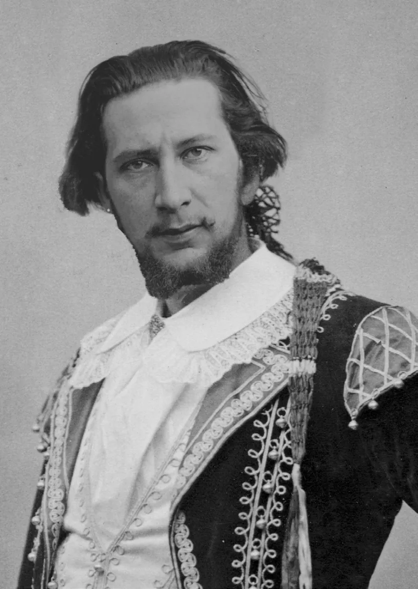
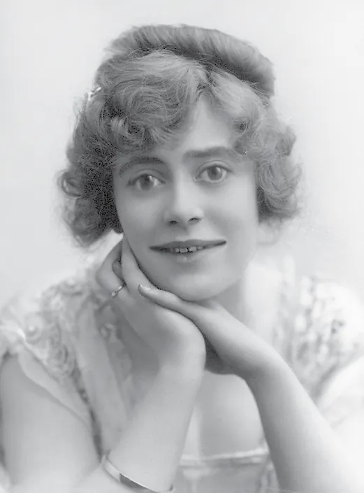

# Действующие лица

### Эдвард Клеверштейн, *38 лет, продюсер Мискатоникского театра*

Художественная натура, жалеющая, что не родилась в другую эпоху. Он твёрдо решил показать Аркхэму «*настоящее искусство*», но его мозг медленно гниёт под влиянием дневника Пикеринга, найденного им полгода назад. Клеверштейн встречает сыщиков, когда они впервые заходят к нему в кабинет, но потом его трудно будет найти до самого конца сценария: он прячется в подвале.

В конце концов Клеверштейн собирается сотворить могущественное заклинание, которое заворожит публику и заставит зрителей передавать друг другу свою энергию по замкнутому кругу, всё усиливая её, — и это пробудит великого бога Азатота. Однако его ждёт неудача.

- **Внешность:** худое как жердь тело Клеверштейна одето по богемной моде конца XIX века. Под расстёгнутым парадным пиджаком — тёмно-красная рубашка с открытым воротом, руки и шею Клеверштейна украшают драгоценности. Из-за смуглой кожи и необычного акцента (он наполовину перуанец, наполовину немец) трудно понять, откуда он родом. Правое ухо проколото; от него исходит землистый запах конопли — не то чтобы совсем неприятный. Грубоватые, слегка раздражённые манеры не вяжутся с его богемной внешностью.
- **Зацепки для отыгрыша:** хочет, чтобы сыщики убрались из театра и не заподозрили, что здесь что-то происходит.

### Женевьева «Джинни» Дюбуа, *25 лет, знойная старлетка театра*

Джинни изображает беспомощную барышню, чтобы люди ей помогали, но под этой маской — заносчивая, жадная старлетка, готовая на всё, чтобы получить своё. Она готова лгать, жульничать и предать кого угодно ради мечты стать голливудской звездой. Джинни — дитя глубоководных и владеет магией, но хочет пожить на суше, пока не превратилась окончательно в лягушачье чудовище. Сыщики впервые встречают Джинни, когда она ссорится с Иэном Смитом. Если её подтолкнуть, той же ночью она вломится на склад реквизита и попытается сжечь театр, чтобы получить страховку.

- **Внешность:** у Джинни молочно-белая кожа, и косметики на ней слишком много. Обесцвеченные светлые волосы уложены локонами; ярко-красное платье того же цвета, что и помада, от неё чуть пахнет лавандой. Присмотревшись, можно заметить, что глаза у неё посажены чуть широковато, кожа слегка потрескалась, а зубы немного великоваты.
- **Зацепки для отыгрыша:** недавно оформила на театр несколько страховых полисов. Если он сгорит дотла, она разбогатеет.
