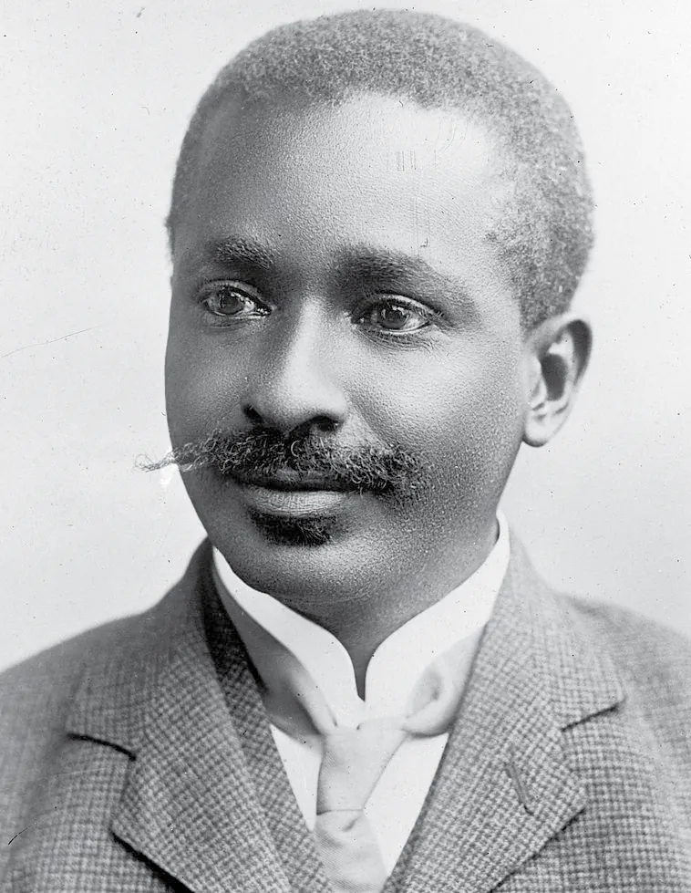

### Франк Тёрнер, *45 лет, уборщик театра*

Франк лишь недавно поступил в штат театра. Его брат-близнец Ксандер был здесь прежним уборщиком и пропал в театре около двух месяцев назад; с тех пор Франк пытается выяснить, что с ним случилось. Франк очень трудолюбив: днём он убирает театр, попутно вынюхивая, нет ли где следов того, что случилось с Ксандером. Франк собирается с духом, чтобы ночью пробраться в театр и обыскать кабинет Клеверштейна и склад реквизита: только там он ещё не успел поискать. Он охотно ухватится за возможность заручиться помощью сыщиков.

- **Внешность:** чернокожий мужчина с проседью, в синем комбинезоне и с внушительными усами. Франк высокий и широкоплечий, рубашка на нём едва сходится.
- **Зацепки для отыгрыша:** его брат Ксандер пропал из театра около двух месяцев назад, незадолго до появления символов.

### Ханна Картер, *28 лет, заведующая постановочной частью*

Ханна — рассудительная заведующая постановочной частью театра. Почти всю жизнь она проводит за кулисами: строит и чинит, а заодно руководит постановочной бригадой. Ей нужны лишние руки за кулисами, и она может нанять сыщиков. Днём Ханна работает за кулисами, а по ночам чинит грузовой лифт, ведущий вниз, на склад реквизита. Это Ханна по приказу Клеверштейна построила все фальшивые стены, которыми полон театр. Она перегружена работой и вымотана.

- **Внешность:** молодая женщина с бледной кожей, в тёмно-синей плоской кепке, из-под которой видны заколотые соломенно-светлые волосы.
- **Зацепки для отыгрыша:** перегружена работой, потому что по указанию Клеверштейна приходится переделывать стены театра. Если что-то пойдёт не так, Ханна тут же позвонит в полицию или вызовет подмогу по телефону из своего кабинета.

