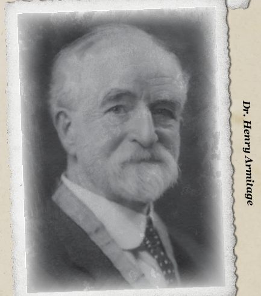

# Начало: пути поиска

Сыщики могут сразу отправиться в театр или сначала провести предварительные поиски. Ниже описано несколько нитей расследования, по которым сыщики могут пойти до или после визита в театр.

## Библиотека Орна (Мискатоникский университет)

Аркхэмский Мискатоникский университет, пожалуй, больше всего известен изучением эзотерических и оккультных наук. Его библиотека Орна — трёхэтажное каменное здание в центре кампуса; всем известно, что в ней хранится солидное собрание старинных фолиантов и других древних текстов.

Брать книги на дом могут только студенты и преподаватели, но для общих изысканий здание открыто для публики с понедельника по субботу.

Днём в библиотеке полно аспирантов и студентов, но руководитель справочного отдела **миссис Диана Лоринг** охотно поможет сыщикам с любыми вопросами — в том числе о таинственном языке, который они расшифровывают, или об истории Аркхэма и Мискатоникского театра. Возможно, у сыщиков есть и давние связи с **доктором Генри Армитеджем**, главой библиотеки Орна.

Вот что сыщики могут искать в библиотеке:

- Сыщики, ищущие другие примеры языка и символов, которые они изучают, не находят ничего в точности такого же. Поэтому миссис Лоринг советует им изучить похожие древние языки (например, язык Му).
- Сыщики, изучающие язык Му, проходят проверку **Работы в библиотеке**. При провале они находят лишь упоминания этого языка, но не сами символы. При успехе они могут сравнить символы, вырезанные на театре, с историческими образцами символов Му. Хотя сходство поразительно во многом, ясно, что изучаемые сыщиками символы — не язык Му.
- Сыщики, изучающие Мискатоникский театр, находят в библиотеке Орна лишь скудные упоминания. При успешной проверке **Работы в библиотеке** они находят театр на картах Аркхэма начиная с 1818 года и ранние фотографии здания рубежа веков (**раздатка «Сцена-1»:** фотография театра). Рассмотрев эти фотографии в лупу, сыщики замечают, что на них символов в кладке ещё нет. Каков бы ни был исход проверки, миссис Лоринг советует заглянуть в местную газету **«Аркхэм Адвертайзер»** (с. 9), чтобы узнать больше.

> **Хранителю на заметку:** сыщики очень часто выстраивают сложные теории и задают вопросы, выходящие за рамки сценария. Если они спросят о том, на что очевидного ответа нет, смело импровизируйте — лучше так, чтобы ответ вёл их обратно к сведениям, важным для сценария.
