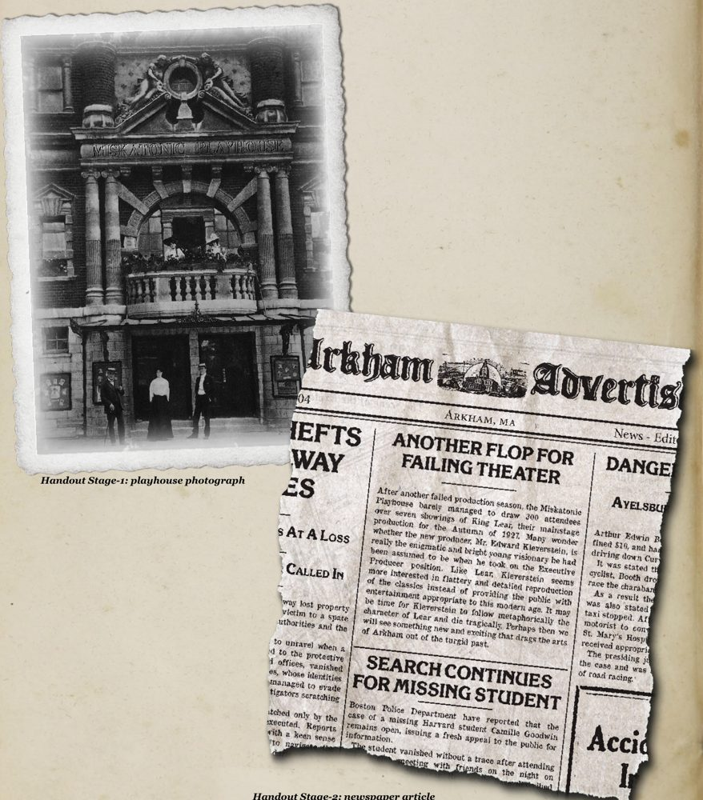

*Слева — раздатка «Сцена-1»: фотография театра; справа — раздатка «Сцена-2»: газетная статья (на этой странице — обрывок полосы). Полные раздатки и их перевод — в приложении «Раздатки» (с. 28 и 29); ниже — перевод главной статьи, видной на обрывке.*

> **Раздатка «Сцена-2»: газетная статья (фрагмент)**
>
> **ЕЩЁ ОДИН ПРОВАЛ ГИБНУЩЕГО ТЕАТРА**
>
> После очередного неудачного сезона Мискатоникский театр едва собрал 300 зрителей за семь показов «Короля Лира» — главной постановки осени 1927 года. Многие задаются вопросом, действительно ли новый продюсер, мистер Эдвард Клеверштейн, — тот загадочный и блестящий молодой провидец, каким его считали, когда он занял пост исполнительного продюсера. Подобно Лиру, Клеверштейн, похоже, больше любит лесть и дотошное воспроизведение классики, чем развлечения, подобающие нашему современному веку. Быть может, Клеверштейну пора, фигурально выражаясь, последовать за Лиром и трагически умереть. Возможно, тогда мы увидим что-то новое и захватывающее, что вытащит искусство Аркхэма из напыщенного прошлого.

*Прим. перев.: в статье — «осень 1927 года», хотя действие сценария идёт осенью 1923 года; оставлено как напечатано.*
