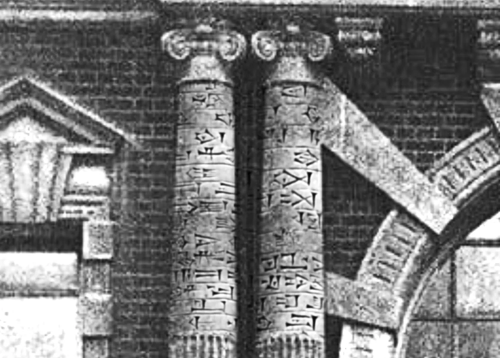

*Раздатка «Сцена-3»: резные символы (текста нет — только символы; та же раздатка — в приложении, с. 30).*

# Театр

Мискатоникский театр — обветшалое здание на Марш-стрит, 552, в Аркхэме; с самого основания лордом Александром Пикерингом-Картером в 1818 году оно привлекало на свою сцену эзотерическое и неведомое. В последнее время театру не везёт: его продюсер **Эдвард Клеверштейн** предпочитает ставить традиционные пьесы на темы утраты и смерти, а не современные постановки, захватившие всю остальную страну. Сборы уже давно иссякают.

Сыщики, пришедшие в театр, могут исследовать разные его части. Все найденные ими нити в конце концов ведут вниз, на склад реквизита, где сыщики должны найти дневник Пикеринга. В сценарии есть несколько второстепенных загадок, но для короткой игры Хранитель может опустить их: пусть **Франк Тёрнер** держит свои беды при себе, а **Джинни Дюбуа** будет недоступна.

## У входа в театр

Двустворчатые двери служат главным входом в высокое каменное здание. Левая створка подпёрта огнетушителем. На правой висит табличка: «*Доставка — с заднего хода*».

Дверь обрамляют греческие колонны, над ней — маленький балкон. Стены по обе стороны двери заклеены обветшалыми афишами следующего спектакля — «*Женщины в бронзе*». Отзывы, видимо, были сдержанными, но афиши гордо выставляют единственный отзыв на три звезды из малоизвестной бостонской газеты.

Все четыре колонны покрыты грубо вырезанными символами (**раздатка «Сцена-3»:** резные символы). Эффект неброский, поэтому пока их почти никто не заметил, но они явно есть и совпадают с символами на внутренней стороне египетской шкатулки. Без долгого изучения дневника Пикеринга из символов ничего не узнать.

> **Хранителю на заметку:** правильно вырезанные, эти символы обычно служат для сдерживания магии и магических существ — но эти вырезаны неправильно.
