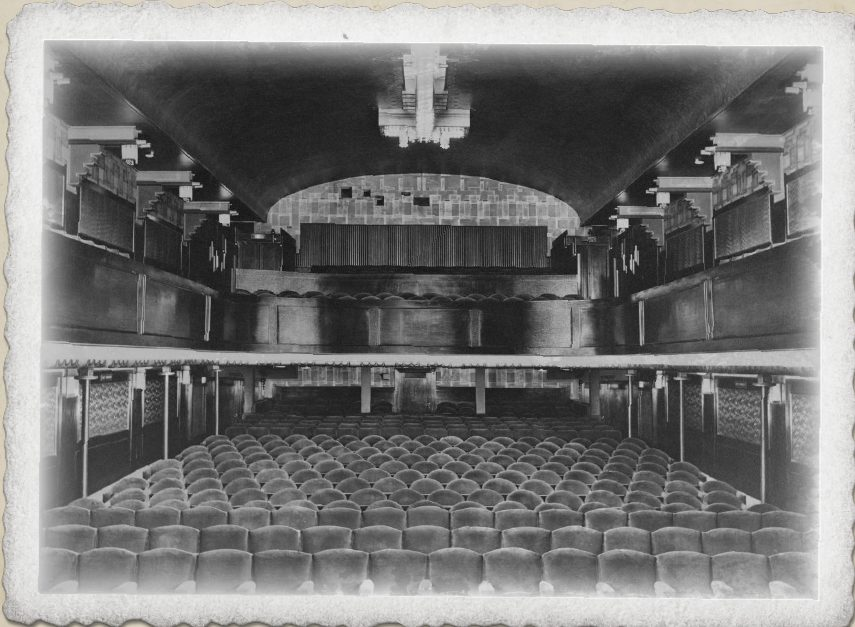

## Переулок

Свернув в соседний переулок, можно выйти к огороженному двору позади театра. Из-за ворот доносятся звуки стройки. Сыщики могут войти через вход для доставки: он не заперт и ведёт за кулисы. В переулке стоят и запертые мусорные баки. Чтобы их открыть, нужен успех проверки **Взлома**. Чтобы порыться в мусоре так, чтобы постановочная бригада не заметила и не прогнала, нужен успех проверки **Скрытности** — если только дело не происходит вечером. В баках сыщики находят мешок для мусора, полный личных вещей, завёрнутых в синий комбинезон с нашивкой «*X. Turner*» на ярлыке. Это запасной комбинезон и другие личные вещи из шкафчика Ксандера Тёрнера, пропавшего брата Франка; Клеверштейн выбросил их после смерти Ксандера. В одном из карманов — запасной ключ от главной двери театра.

## Фойе

Фойе театра знавало лучшие дни: когда-то ярко-красное сукно выцвело и покрылось пятнами, плиточный пол исцарапан и в выбоинах, деревянные панели облупились и кое-как подлатаны. Всё пропахло застарелым попкорном и дезинфекцией. Издалека, из-за театра, слышен стук плотников. В фойе только один человек — уборщик **Франк Тёрнер**. Он моет исцарапанный плиточный пол. Когда сыщики входят, Франк рявкает: «*Мы закрыты*» — и сердито смотрит на них, ожидая, что они уйдут.

На Франка не действуют ни **Обаяние**, ни **Запугивание**. Однако достаточно сказать, что сыщики пришли к Клеверштейну, — и их пропустят. Иначе придётся солгать, чтобы пройти мимо него (проверка **Красноречия**), или быть очень убедительными (трудная проверка **Убеждения**) — например, упомянув символы снаружи. Попытка просто протиснуться мимо Франка — верный способ разозлить и его, и всю постановочную бригаду. Только отважная компания сыщиков решится противостоять всей постановочной бригаде театра: всего Франк может позвать на помощь восьмерых крепких рабочих.

Если удачными проверками навыков сыщики успокоят Франка, он может показать им дорогу в кабинет Клеверштейна. Франк может и рассказать, что нанялся в театр, чтобы найти пропавшего брата-близнеца Ксандера. По словам Франка, Ксандер был порядочным парнем, которого очень любила семья. Ксандер проработал в театре всего несколько месяцев, когда вдруг бесследно исчез. Франк уверен, что Ксандер пропал на работе, и так же уверен, что продюсер Эдвард Клеверштейн знает больше, чем говорит. Франк думает, что разгадка — на складе реквизита в подвале: он замечает, как трудно стало туда попасть с тех пор, как Ханна Картер построила деревянную стену, закрывшую лестницу за кулисами, — теперь вниз ведёт только грузовой лифт. Франк охотно ухватится за предложенную помощь и посоветует сыщикам обследовать театр ночью.

