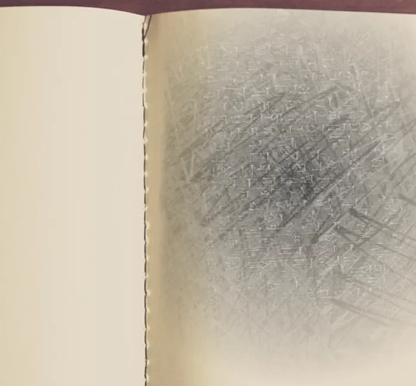

## Кабинет Клеверштейна

Узкая крутая лестница в кабинет Клеверштейна зловеще скрипит, но приводит в просторный, светлый кабинет. Он больше похож на богемную квартиру-студию. В углу стоит смятая постель, заваленная брошенными коробками из-под еды: похоже, Клеверштейн здесь не только работает, но и живёт. Пустые бутылки из-под самых разных крепких напитков брошены почти на каждой ровной поверхности. Сильно пахнет табачным дымом и потом. В западной стене есть дверь, но её загораживает большой комод, и к тому же она оказывается заперта. Восточную стену рядом с кроватью занимает длинный книжный шкаф. В южной стене напротив лестницы и входа — три больших окна, а перед ними — большой заваленный стол. Эдвард Клеверштейн театрально раскинулся на среднем подоконнике на фоне аркхэмских крыш и курит тонкую самокрутку. Он читает какую-то рукопись. Когда сыщики входят, он поднимает глаза и, потягиваясь, спускается со своего насеста.

> **Хранителю на заметку:** сыщиков, сумевших открыть дверь в западной стене, ждёт обрыв высотой в два этажа в оркестровую яму театра. Когда-то эта дверь вела в ложу продюсера, но кресла убрали при одной из многих перестроек. Настоящая потайная дверь — за книжным шкафом.

При встрече с Клеверштейном каждый сыщик проходит проверку **НАР**. Клеверштейна привлекают и мужчины, и женщины, и к тем сыщикам, кого он находит привлекательными, он относится гораздо благосклоннее.

Клеверштейну любопытно, зачем пришли сыщики, но о делах театра он говорит охотно.

- О поисках Франком брата-близнеца Ксандера он почти ничего не может сказать: «*Его брат однажды утром не вышел на смену. Хорошо, что Франк — надёжный работник. Куда лучше, чем был его брат*». Сыщики, прошедшие проверку **Психологии**, чувствуют, что Клеверштейн, возможно, знает больше, но вряд ли расскажет что-то ещё — по крайней мере без изрядного количества выпивки или других стимуляторов.
- О Джинни он восклицает: «*Боже, эта женщина! Не будь у неё такой богатой семьи, я бы ещё несколько месяцев назад задвинул её в задний ряд. Петь не умеет, танцевать не умеет, играть еле-еле умеет. Жду не дождусь того дня, когда она сбежит в Голливуд и с треском провалится*».
- О Ханне он говорит: «*К ней не придерёшься, работяга до мозга костей. Всегда рада решить проблемы, которые то и дело всплывают*».

Если сыщики спросят Клеверштейна об оккультных языках или принесут с собой какие-нибудь образцы символов, Клеверштейн охотно взглянет на то, что они нашли.

Из-за знакомства с дневником Пикеринга Клеверштейн может переводить оккультный язык, который пытаются расшифровать сыщики, и даже может бормотать себе под нос слова того, что читает. Успех проверки **Психологии** или **Чтения по губам** даёт сыщикам понять, что он способен понимать символы. Однако Клеверштейн качает головой и сожалеет, что не может помочь. Он признаёт, что символы поразительно похожи на вырезанные снаружи здания, и советует сыщикам спросить Ханну Картер, заведующую постановочной частью.

Клеверштейн вовсе не хочет подпускать сыщиков к дневнику Пикеринга и полагает, что уж Ханна-то меньше всех способна хоть чем-то им всерьёз помочь. Он надеется, что после встречи с ней они потеряют интерес и уйдут.

Если сыщики проберутся в кабинет Клеверштейна в его отсутствие, роясь в его вещах, они найдут немногое, кроме поразительного количества пустых бутылок из-под спиртного — разумеется, всё это в эпоху сухого закона вопиюще незаконно. Единственное, что интересно в комнате, — запертый ящик стола. Замок можно вскрыть проверкой **Взлома** или грубой силой. Если сыщики повредят стол, Клеверштейн это заметит и (справедливо) решит, что виноваты сыщики (если он с ними встречался).

В запертом ящике — бутылка абсента, $400 разными купюрами и пустой блокнот. На блокноте остались сильные отпечатки, и сыщики могут, потерев их карандашом, снять оттиск последней записи Клеверштейна (**раздатка «Сцена-4»:** блокнот). Оттиск показывает символы, совпадающие с теми, что вырезаны на театре.

Если сыщики пришли сюда с Франком, он упоминает, что Клеверштейн никогда не разрешает ему трогать книжные полки. Если снять с полки все книги и рукописи, за *«Полным собранием сочинений Уильяма Шекспира»* найдётся маленькая спрятанная кнопка. От кнопки книжный шкаф отъезжает в сторону, открывая узкую лестницу вниз, на **склад реквизита** (с. 17).

*Раздатка «Сцена-4»: блокнот (текста нет — только символы; та же раздатка — в приложении, с. 31).*
