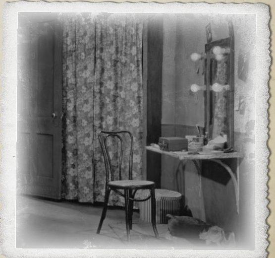

## Гримёрные

Сыщики, бродящие по театру днём (например, после встречи с Клеверштейном или уйдя из закулисья), слышат шум, доносящийся из нескольких маленьких комнат. Раздаётся пронзительный визг, из-за угла выбегает женщина и бросается в объятия самого крепкого на вид сыщика. Она (вот так вдруг!) заливается слезами и умоляет сыщиков: «*Прошу вас, помогите, спасите меня от этого грубияна! Защитите мою честь от его гнусных выходок!*» Это **Женевьева «Джинни» Дюбуа**.

За ней неторопливо следует мужчина в тёмном костюме и широкополой шляпе. Хотя он в помещении, на нём тёмные очки. Это **Иэн Смит**, юрист семьи Джинни.

Джинни — молодой гибрид глубоководного; она решила пожить на суше в поисках богатства, вдали от семьи. Она рассчитывала на быстрый взлёт к славе: купила себе главную роль в маленьком, едва сводящем концы с концами театре, надеясь подняться на гребне нарастающего успеха и рвануть в Голливуд! К несчастью, настоящего таланта у неё нет, а критику она не выносит. Она застряла в Аркхэме уже на три года и всё ждёт своего звёздного часа.

Иэну Смиту под пятьдесят, и его превращение в глубоководного зашло куда дальше, чем у Джинни, хотя в шляпе, тёмных очках и перчатках он ещё кое-как сходит на людях за человека. Иэн пришёл сказать Джинни, что денежное дерево засыхает и семья больше не будет её содержать. Джинни намерена устыдить Иэна, чтобы он позволил ей остаться до конца этого сезона и она наконец «*прославилась*». Если не выйдет, запасной план Джинни — сжечь театр и получить деньги по страховому полису, в который она вложилась. Иэн же твёрдо намерен добиться, чтобы Джинни наконец отказалась от своих мечтаний и вернулась домой.

*Прим. перев.: возраст Иэна в книге не сходится: 30 лет (с. 6), 25 (статблок, с. 22) и «от сорока пяти до пятидесяти» здесь; база следует 30 годам.*

Ссора продолжается на глазах у сыщиков: Джинни бросает Иэну всё более дикие обвинения, а потом театрально «*падает в обморок*» на руки сыщикам. Тут Иэн в ярости уходит. Если сыщики заступятся за Джинни, она поблагодарит их «*от всего своего простого провинциального сердечка*» и охотно поболтает с ними обо всём, что касается театра:

- О поисках Франком брата-близнеца Ксандера она признаётся: «*Я даже не поняла, что это новый человек! Они так похожи! Ксандер был лентяй. Я часто ловила его, когда он курил в каком-нибудь тихом углу, хотя должен был работать*».
- О Ханне: «*Ханна — просто чудо, хотя я немного не понимаю, что это за работы она в последнее время затеяла. В подвал теперь так просто не попасть, а я любила летом спускаться туда охладиться*».
- О Клеверштейне: «*Фу, этот человек! Терпеть не могу ни его, ни его бесконечную вереницу унылых пьес. Почему бы нам не сыграть что-нибудь повеселее, что-нибудь популярное, ради всего святого!*»
- Об Иэне: «*Совершенно невыносим! Я ему говорила, эта постановка станет большим хитом! Он хочет, чтобы я вернулась домой к семье. Я ему говорила и скажу ещё миллион раз — это вложение окупится. Я ему обещала. А я всегда держу слово!*»

Если сыщики спросят её об оккультных надписях на стенах, она удивится, услышав о них: «*Во время нашего прошлого сезона их точно не было! Должно быть, это появилось недавно*». Если надавить, она ведёт сыщиков в свою гримёрную (там страшный беспорядок и слегка пахнет рыбой) и показывает фотографии, где она снята у здания. По её словам, их сделали три недели назад.

> **Хранителю на заметку:** сыщики, прошедшие проверку **Внимания**, замечают, что у Иэна и Джинни есть общие черты, наводящие на мысль о родстве. У обоих широко расставленные глаза, к тому же больше обычного. Проницательные игроки (если не их сыщики) могут понять, что у обоих персонажей «*иннсмутская внешность*»: это дети глубоководных, которые часто проводят юность на суше, пока ещё выглядят людьми, а позже превращаются в гротескных существ, известных как глубоководные. В детстве они выглядят совсем как люди, но с возрастом у них проявляется всё больше черт их водных предков. Кожа становится сухой, глаза выпучиваются, шея усыхает, голос делается квакающим. Джинни скрывает многое под толстым слоем грима, но всё равно выглядит более чем странно.

