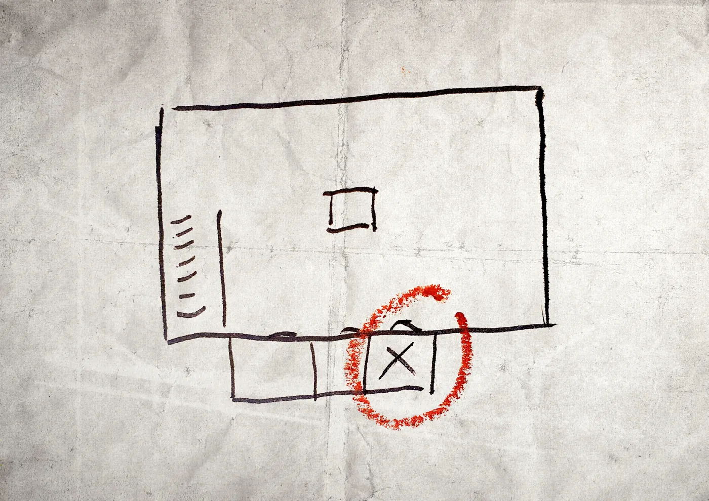

Если показать Джинни символы, она отказывается даже на них смотреть. Успех проверки **Психологии** показывает, что Джинни вне себя от злости, обнаружив странные дела в «*её*» театре. Рисковать она не желает. Узнав о символах, Джинни решает ускорить свои планы: теперь она вломится на склад реквизита в тот же вечер, чтобы поджечь его и сжечь театр дотла.

Если сыщики проберутся в гримёрную Джинни в её отсутствие, они обнаружат отчаянный беспорядок. Брошенная одежда — почти на каждой поверхности. Десятки фотографий Джинни на встречах с мелкими знаменитостями. Хоть сколько-нибудь чисто только у стола с большим гримёрным зеркалом в обрамлении ламп накаливания. Но и тут по столу разбросаны карандаши для ресниц и засохшие спонжи для грима. Всё пропахло дорогими духами, которые не до конца перебивают пропитавший воздух рыбный запах. Обыскав стол, сыщики находят карту склада реквизита в подвале, на которой кладовая пиротехники обведена помадой (**раздатка «Сцена-5»:** карта).

В столе есть и беспорядочные бумаги: чтобы в них разобраться, нужен успех проверки **Бухгалтерского дела**. Или сыщики могут отнести бумаги Иэну Смиту — он разберётся, что Джинни оформила на театр три отдельных страховых полиса. По всем трём, если театр сгорит, крупные выплаты получит лично Джинни.

## Слежка за Иэном Смитом

Проследив за Иэном Смитом, когда он в ярости уходит после ссоры с Джинни, или разыскав его позже, сыщики могут найти его в снятой неподалёку конторе. Если сыщики постучат в дверь, прежде чем войти, Иэн будет в той же шляпе и тёмных очках, что и при встрече в театре. Если же они вломятся или попытаются подсмотреть за Иэном в окно, то увидят Иэна без шляпы и очков, в его истинном облике. Увидевший его облик гибрида глубоководного проходит проверку **Рассудка** (потеря 0/1d6).

### Добрый полицейский

Сыщики могут обойтись с Иэном вежливо — например, попросить рассказать его версию недавней ссоры с Джинни. В ответ он тяжело вздыхает и закуривает. Квакающим голосом он объясняет, что Джинни «*из богатой семьи*», но последние несколько лет тратит больше, чем семья может себе позволить. Она набрала долгов на тысячи долларов, и с семьи довольно. Хотя семья поклялась больше её не выручать, Иэн подозревает, что Джинни задумала какое-то безумство. Сыщиков ждёт небольшая награда ($20), если они согласятся помочь ему выяснить, что именно.

Если сыщики принесут бумаги со страховыми полисами из гримёрной Джинни, Иэн поймёт, что Джинни собирается сжечь театр — вероятно, с помощью пиротехники, хранящейся на складе реквизита. Он попросит сыщиков помочь ему её остановить.

### Злой полицейский

Сыщики могли встать на сторону Джинни и решить затеять драку с Иэном или увидеть истинный облик Иэна. Он не станет отбиваться, если его жизнь не в опасности, а вместо этого сбежит и вызовет полицию. Лишь если другого выхода не будет, он применит заклинание **Дыхание глубин**, чтобы вывести сыщиков из строя.

*Раздатка «Сцена-5»: карта (подписей нет; та же раздатка — в приложении, с. 32).*
