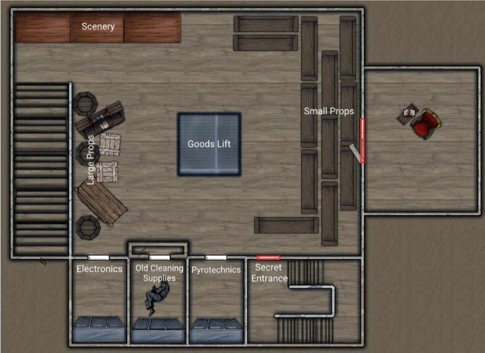

**Подписи на плане «Сцена-1»: склад реквизита**

| На плане | Перевод |
|---|---|
| Scenery | Декорации |
| Large Props | Крупный реквизит |
| Goods Lift | Грузовой лифт |
| Small Props | Мелкий реквизит |
| Electronics | Электрооборудование |
| Old Cleaning Supplies | Старая кладовая уборщика |
| Pyrotechnics | Пиротехника |
| Secret Entrance | Тайный вход |
| N | С (север) |

*Без подписей на плане: справа, за стеллажами мелкого реквизита, — тайная комната с креслом и дневником; слева — лестница из закулисья, закрытая стеной.*

## Склад реквизита

Сыщики могут попасть в подвал, на склад реквизита, тремя путями:

- проломив недавно построенную стену, закрывающую лестницу: тогда они входят с западной стороны помещения;
- спустившись на грузовом лифте: лифт может застрять, но доставит сыщиков в середину помещения;
- проскользнув по тайной лестнице: в неё попадают из кабинета Клеверштейна, и она позволяет сыщикам войти через потайную стену в юго-восточном углу помещения.

Склад реквизита находится прямо под закулисьем. Вдоль северной стены хранятся декорации. Вдоль западной — крупный реквизит и мебель. Восточную сторону помещения в несколько рядов занимают большие передвижные стеллажи. За стеллажами — фальшивая стена, скрывающая дневник Пикеринга. Отодвинув стеллажи на колёсах, сыщики должны пройти проверку **Внимания**, чтобы заметить фальшивую стену.

На юге — три кладовые. В первой — ряд шкафов с электрооборудованием и осветительными приборами. Вторая кладовая закрыта деревянной стеной — такой же, как та, что перекрывает лестницу. Прежде в этой кладовке хранили инвентарь для уборки, а теперь в ней лежит мёртвое тело Ксандера. Третья кладовая заперта, в ней — пиротехнические припасы.

На складе реквизита сыщики могут найти множество элементов декораций, задников и других частей оформления сцены. Здесь много щитов-декораций разного размера с видами вроде:

- тёмного одинокого острова со средневековой церковью на холме вдали;
- особняка эпохи Регентства с садом у реки;
- бесплодного поля, превращённого в нескончаемую пыльную чашу.

У западной стены беспорядочно громоздятся крупный реквизит и мебель. Среди диванов и кресел разных стилей выделяется кое-что:

- альпака в натуральную величину — такая реалистичная, будто это чучело;
- действующий ткацкий станок с незаконченным полотном;
- реалистичный средневековый рыцарский доспех с удивительно острой на вид пикой.

Восточную стену в несколько слоёв закрывают стеллажи. Они на колёсах, их можно передвигать, и за ними обнаруживается всевозможный реквизит, в том числе:

- плевательница;
- свисток кондуктора;
- старая рождественская ёлка с подарками для какого-то «*Крампуса*»;
- пузырёк со светящейся фиолетовой слизью.

Хранителю предлагается добавить свой реквизит и поощрять сыщиков пускать его в ход в последующих встречах с разными странными сущностями склада.
