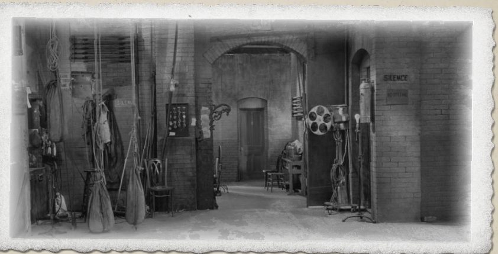

# Развязка

Театр может сгореть или уцелеть — в зависимости от действий Джинни, Клеверштейна и/или сыщиков. Сыщики могут уйти, унося с собой проклятую книгу. А могут потерпеть полное поражение и уйти ни с чем, кроме новых шрамов. Что бы ни случилось, главные вопросы, на которые нужно ответить, таковы:

- Что стало с театром?
- Что стало с Клеверштейном?
- Нашёл ли Франк брата?
- Что стало с Джинни?
- Приблизились ли сыщики хоть немного к пониманию древнего языка?

## Судьба театра

- Если дневник Пикеринга покинет стены театра (с Клеверштейном или с сыщиками), он начнёт пожирать того, кто его держит, медленно сводя его с ума.
- Если Джинни удастся получить страховку, она уедет в Голливуд и снимет череду совершенно ужасных фильмов, которые отбросят киноиндустрию назад почти на десятилетие.
- Если Франк выживет, найдя Ксандера, он тихо похоронит потерянного брата, а потом займётся местной политикой, пытаясь навести порядок в Аркхэме и сделать город безопаснее для всех.
- Если Клеверштейн выживет и театр уцелеет, он продолжит свою работу и со временем освоит тёмные заклинания из дневника, будет завораживать местную публику и копить силу, чтобы связаться с самим Азатотом.
- Если Клеверштейн погибнет и/или театр сгорит, со временем новый инвестор возьмётся вернуть зданию былую славу.

## Награды

Выжившим сыщикам после окончания сценария положена фаза развития.

- Как проходит фаза развития сыщиков, см. **«Награда за опыт: фаза развития сыщиков»** («Книга хранителя» «Зова Ктулху», с. 94).
- Лечение ран — **«Выздоровление от обычного урона»** и **«Выздоровление от серьёзных ран»** («Книга хранителя» «Зова Ктулху», с. 121).
- Восстановление пунктов Рассудка через время, проведённое с элементом предыстории, — **«Самолечение»** («Книга хранителя» «Зова Ктулху», с. 167).

Кроме потерь Рассудка, описанных в других местах сценария, примените следующие прибавки и потери Рассудка:

- найти и благополучно забрать дневник Пикеринга: +1d8 пунктов Рассудка, +5% к Мифам Ктулху;
- если Франк раскрыл исчезновение брата и выжил: +1d10 пунктов Рассудка;
- если театр сгорел: −1d6 пунктов Рассудка;
- если Франк погиб: −1d6 пунктов Рассудка;
- если Ханна погибла: −1d6 пунктов Рассудка.

## Продолжение кампании

- Если сыщики пережили этот сценарий, вам, возможно, захочется найти другие сценарии на похожие темы. Мы советуем *«Flesh Wounds»* («Раны плоти») Пита Бёрджесса: извращённая наука и тёмная магия Мифов объединяются, чтобы выпустить на волю новый ужас — прожорливую, голодную плоть. Сумеет ли группа студентов покончить с хаосом, прежде чем он поглотит Аркхэм?
- Ищете сценарий в определённом месте? Почему бы не заглянуть на нашу карту сценариев (Scenario Map)?
- Хотите ещё чего-нибудь от Miskatonic Playhouse? Загляните на www.MiskatonicPlayhouse.com
