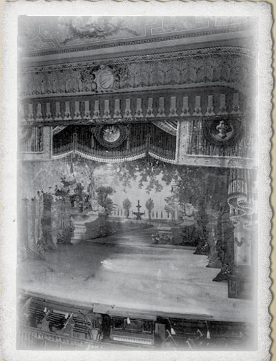

### Франк Тёрнер, *45 лет, уборщик театра*

```stat
СИЛ 80    ВЫН 60    ТЕЛ 70    ЛВК 55    ИНТ 60
НАР 60    МОЩ 50    ОБР 40    Рассудок 50   ПЗ 13
БкУ: +1d4   Комплекция: 1   СКО: 7    ПМ: 10

Бой
Ближний бой (драка)   45% (22/9), урон 1d3+1d4
Уклонение             27% (13/5)

Навыки
Искусство/ремесло (уборка) 55%, Родной язык (английский) 45%, Слух 40%,
Оккультизм 5%, Психология 40%.
```

### Ханна Картер, *28 лет, заведующая постановочной частью*

```stat
СИЛ 65    ВЫН 75    ТЕЛ 45    ЛВК 70    ИНТ 55
НАР 50    МОЩ 60    ОБР 45    Рассудок 60   ПЗ 11
БкУ: 0    Комплекция: 0   СКО: 7    ПМ: 12

Бой
Ближний бой (драка)   25% (12/5), урон 1d3
Уклонение             35% (17/7)

Навыки
Искусство/ремесло (плотницкое дело) 70%, Родной язык (английский) 45%,
Внимание 40%.
```

*Прим. перев.: так в оригинале — ПЗ 11 (по ВЫН 75 и ТЕЛ 45 выходит 12) и Скорость 7 (при СИЛ 65 и ЛВК 70 больше ТЕЛ 45 должно быть 9).*

### Иэн Смит, *25 лет, юрист*

```stat
СИЛ 55    ВЫН 60    ТЕЛ 65    ЛВК 60    ИНТ 45
НАР 35    МОЩ 90    ОБР 45    Рассудок 90   ПЗ 12
БкУ: 0    Комплекция: 0   СКО: 7    ПМ: 12

Бой
Когтистые лапы        45% (22/9), урон 1d8
Уклонение             30% (15/6)

Навыки
Мифы Ктулху 20%, Родной язык (английский) 45%, Юриспруденция 50%,
Оккультизм 40%, Убеждение 35%, Психология 25%.

Заклинания
Дыхание глубин   Стоимость: 8 пунктов магии. Заклинатель должен выиграть
                 встречную проверку МОЩ против цели. При успехе лёгкие цели
                 наполняются морской водой — 1d8 урона за раунд, пока цель
                 не пройдёт чрезвычайную проверку ВЫН.
```

*Прим. перев.: возраст здесь — 25 лет, в «Действующих лицах» — 30, в сцене в гримёрных — «под пятьдесят»; база следует 30 годам. Так в оригинале и БкУ 0 (при СИЛ 55 + ТЕЛ 65 = 120 положены +1d4 и Комплекция 1), и ПМ 12 (при МОЩ 90 должно быть 18).*

## Чудовище

### Ксандер Тёрнер, *45 лет, бывший уборщик театра*

```stat
СИЛ 80    ВЫН 60    ТЕЛ 70    ЛВК 55    ИНТ 0
НАР 0     МОЩ 50    ОБР 40    Рассудок 0    ПЗ 13
БкУ: +1d4   Комплекция: 1   СКО: 7    ПМ: 10

Бой
Атак за раунд: 2
Ближний бой (драка)   60% (30/12), урон 1d3+1d4
Уклонение             27% (13/5)

Броня: стойкость ко всем физическим атакам — получает половину урона.

Заклинания
Песнь служителей   Пронзительный вопль, от которого все вокруг временно
                   глохнут. Каждый, кто слышит вопль, должен пройти проверку
                   МОЩ, иначе на один раунд выбывает из строя.
```


