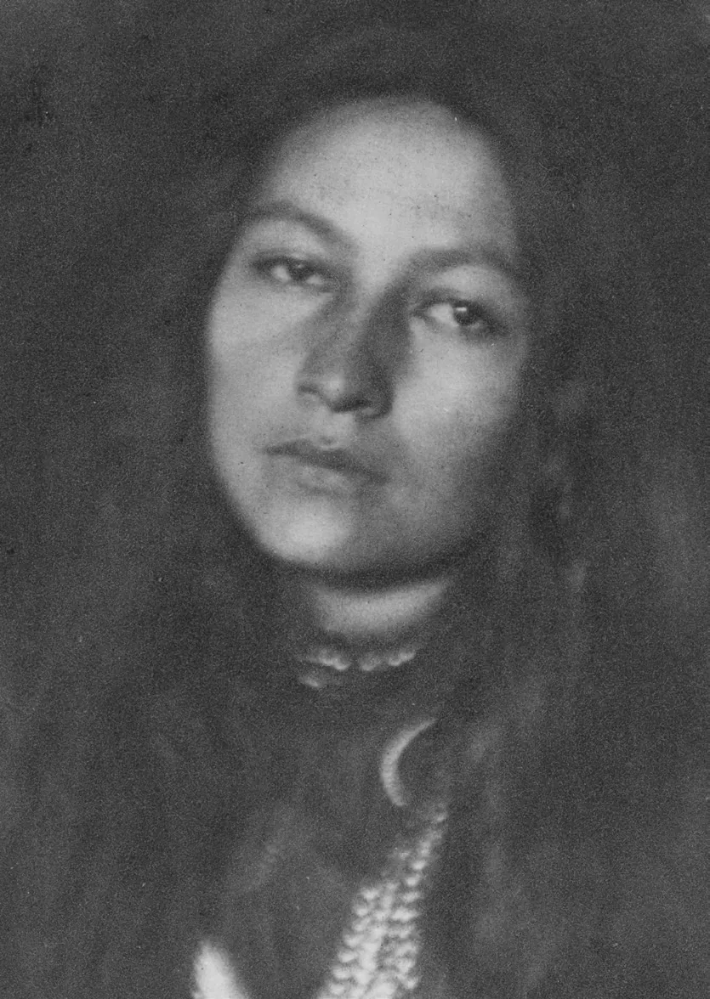

# Готовые сыщики

## Клара Винду

**Возраст:** 22. **Занятие:** студентка / альпинистка

```stat
СИЛ 50    ВЫН 55    ТЕЛ 55    ЛВК 70    ИНТ 90
НАР 55    МОЩ 65    ОБР 70    Рассудок 65   ПЗ 11
БкУ: 0    Комплекция: 0   СКО: 8    ПМ: 13    Удача: (3d6)×5

Навыки
Обаяние                        50% (25/10)
Лазание                        70% (35/14)
Средства                       40% (20/8)
Прыжки                         50% (25/10)
Родной язык (английский)       70% (35/14)
Иностранный язык (навахо)      70% (35/14)
Слух                           40% (20/8)
Взлом                          50% (25/10)
Естествознание                 20% (10/4)
Ориентирование                 50% (25/10)
Оккультизм                     20% (10/4)
Убеждение                      30% (15/6)
Психология                     40% (20/8)
Скрытность                     50% (25/10)
Выживание (верёвки/узлы)       40% (20/8)
Чтение следов                  20% (10/4)

Бой
Ближний бой (драка)   41% (20/8), урон 1d3
Уклонение             35% (17/7)
```

**Предыстория**

Формально Клара — студентка географического факультета Мискатоникского университета, но больше времени она проводит, исследуя мир, чем в сухих академических стенах. С тех пор как она поступила в университет, она побывала почти во всех экспедициях, какие только смогла найти, и уже повидала все крупные континенты.

Клара вступила в Общество исследователей необъяснимого в надежде на новые невероятные приключения. Её зовут на дело впервые, и она немного разочарована, что ехать никуда в экзотические края не придётся.

- **Описание:** худая и гибкая, Клара сложена как скалолазка. Обычно она тепло укутана от аркхэмской погоды: большая непромокаемая куртка и несколько тёплых свитеров.
- **Черты характера:** любознательна, легко заводит друзей и легко вписывается в любое общество. С ней легко говорить.
- **Идеалы и принципы:** самое интересное в мире — там, снаружи, а не в этих стенах.
- **Травмы и шрамы:** на руках у Клары впечатляющие шрамы и следы травм от мелких несчастных случаев на скалах.
- **Значимые люди:** моя семья — там, в том, что осталось от народа навахо. Им не нравится, что я уехала, но мне страшно подумать, что с ними что-то случится.
- **Важные места:** знаю, что должна гордиться своим народом навахо, но мне всегда хотелось увидеть остальной мир. Вот я и уехала.
- **Ценное имущество:** маленькое ожерелье с альпакой, добытое в путешествии по Южному материку.

Ещё один сценарий с Кларой — *«Alpaca on a Plane»* («Альпака в самолёте») Джона Хеджа.


