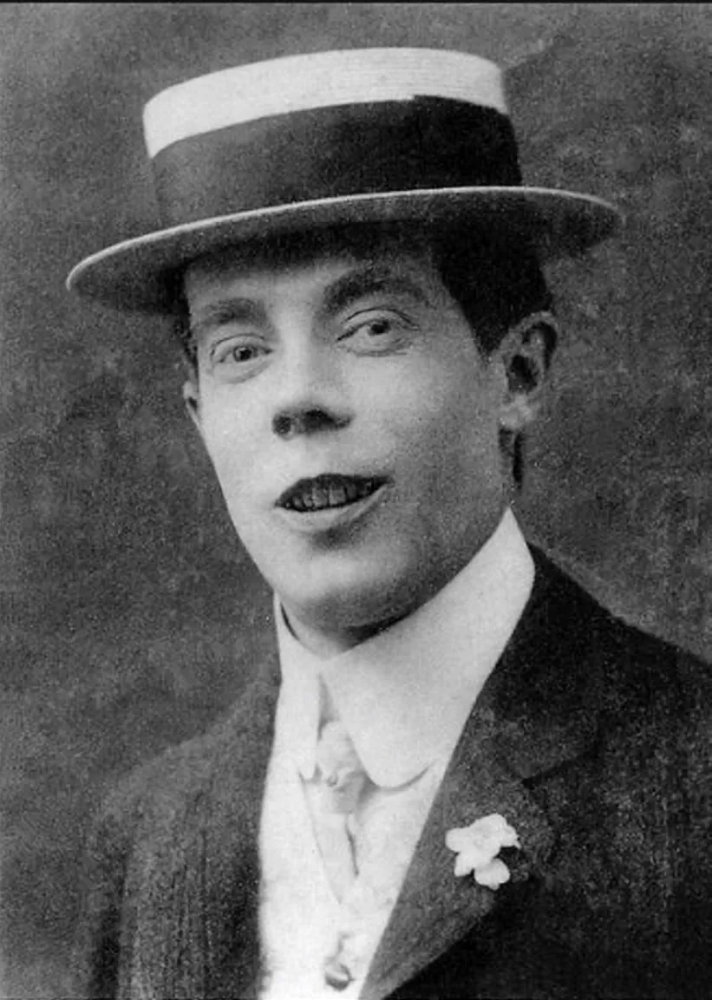

## Хьюго «Шримпи» Харгривз

**Возраст:** 27. **Занятие:** студент / джентльмен

```stat
СИЛ 45    ВЫН 55    ТЕЛ 45    ЛВК 45    ИНТ 65
НАР 70    МОЩ 60    ОБР 70    Рассудок 60   ПЗ 10
БкУ: 0    Комплекция: 0   СКО: 8    ПМ: 12    Удача: (3d6)×5

Навыки
Бухгалтерское дело                          36% (18/7)
Искусство/ремесло (публичные выступления)   45% (22/9)
Обаяние                                     60% (30/12)
Средства                                    80% (40/16)
Красноречие                                 21% (10/4)
История                                     30% (15/6)
Родной язык (английский)                    70% (35/14)
Иностранный язык (латынь)                   45% (22/9)
Слух                                        45% (22/9)
Верховая езда                               25% (12/5)
Наука (ботаника)                            15% (7/3)
Ловкость рук                                55% (27/11)

Бой
Ближний бой (драка)     40% (20/8), урон 1d3
Охотничья винтовка*     35% (17/7), урон 1d10
Уклонение               22% (11/4)

* надёжно заперта в оружейном сейфе в его студенческом жилье
```

**Предыстория**

Хьюго никогда не нравилось его имя, поэтому, когда школьные приятели прозвали его Шримпи («Креветка») за невысокий рост, он с радостью подхватил прозвище. Мать Шримпи, отчаянно желавшая дать ему достойное образование, решила отправить его в Америку, подальше от этих проклятых друзей. Но прозвище он всё равно сохранил.

По сути, Шримпи купил себе место в Обществе исследователей необъяснимого: он обеспечивает все угощения и улаживает неприятности, когда комнату ненароком бронируют дважды. Он надеется, что эти «добрые» дела купят ему друзей.

- **Описание:** привлекательный мужчина невысокого роста, Шримпи хорошо одет и ухожен.
- **Черты характера:** склонен считать, что люди будут перед ним лебезить, и немного теряется, когда этого не происходит.
- **Идеалы и принципы:** пока не вполне понимает, кто он такой: свобода для поисков появилась у него лишь недавно. Вот он и исследует собственную личность.
- **Травмы и шрамы:** в детстве Шримпи сильно сломал ногу на матче по регби. Он так и не оправился полностью и в дождь иногда прихрамывает.
- **Значимые люди:** мамочка, папочка и няня.
- **Важные места:** ему скорее нравятся Соединённые Штаты — потому что это не старая добрая Англия. Больше ему ничего и не нужно.
- **Ценное имущество:** карманные часы деда.

Ещё один сценарий со Шримпи — *«The Dragon of Wantley»* («Дракон из Уонтли») С. Р. Селленс.


