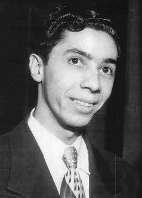

## Луис Карлос Андриани

**Возраст:** 21. **Занятие:** студент-фармаколог

```stat
СИЛ 60    ВЫН 50    ТЕЛ 60    ЛВК 65    ИНТ 90
НАР 60    МОЩ 60    ОБР 75    Рассудок 60   ПЗ 11
БкУ: 0    Комплекция: 0   СКО: 8    ПМ: 12    Удача: (3d6)×5

Навыки
Средства                       10% (5/2)
Электрика                      48% (24/9)
Первая помощь                  40% (20/8)
Родной язык (английский)       50% (25/10)
Иностранный язык (испанский)   75% (37/15)
Работа в библиотеке            65% (32/13)
Слух                           45% (22/9)
Медицина                       40% (20/8)
Естествознание                 40% (20/8)
Оккультизм                     45% (22/9)
Убеждение                      38% (19/7)
Психология                     30% (15/6)
Наука (химия)                  30% (15/6)
Наука (фармакология)           60% (30/12)
Внимание                       60% (30/12)
Скрытность                     35% (17/7)

Бой
Ближний бой (драка)   25% (12/5), урон 1d3
Уклонение             40% (20/8)
```

*Прим. перев.: так в оригинале — БкУ 0, хотя при СИЛ 60 + ТЕЛ 60 = 120 положены БкУ +1d4 и Комплекция 1.*

**Предыстория**

Единственный ребёнок, рано осиротевший, Луис рос у бабушки — травницы по ремеслу — в приморском городке Маягуэс в Пуэрто-Рико. Луиса заворожили странные бабушкины снадобья и эликсиры, и он узнал от неё всё, что мог. Небольшое наследство он потратил на учёбу, а его способности к медицине и химии принесли ему редкую стипендию на изучение фармакологии.

В ноябре прошлого года Луис приехал в США, чтобы продолжить учёбу в Мискатоникском университете как студент по переводу. Профессора считают его восходящей звездой и просто обожают за мягкий, скромный нрав. Это и привело его в Общество исследователей необъяснимого (ОИН), которое он находит очень увлекательным.

- **Описание:** толковый и практичный молодой человек, Луис излучает спокойствие и доброту. Он коротко стрижётся и не слишком заботится о внешности.
- **Черты характера:** по-настоящему мягкая душа, но не без озорства. Легко заводит друзей. Он по натуре избегает ссор, но защитится, если его допечь.
- **Идеалы и принципы:** Луиса воспитали католиком, но он скорее агностик. В церковь он ходил лишь по настоянию бабушки и, переехав в Аркхэм, больше не ходит.
- **Значимые люди:** любящая бабушка Маргерит Андриан — женщина, не терпящая дураков, превыше всего ценившая образование Луиса.
- **Важные места:** учёба в Мискатоникском университете для Луиса — всё. Он именно там, где хочет быть.
- **Ценное имущество:** серебряный медальон святого Христофора, принадлежавший его покойной матери.

Ещё один сценарий с Луисом — *«Flesh Wounds»* («Раны плоти») Пита Бёрджесса.


