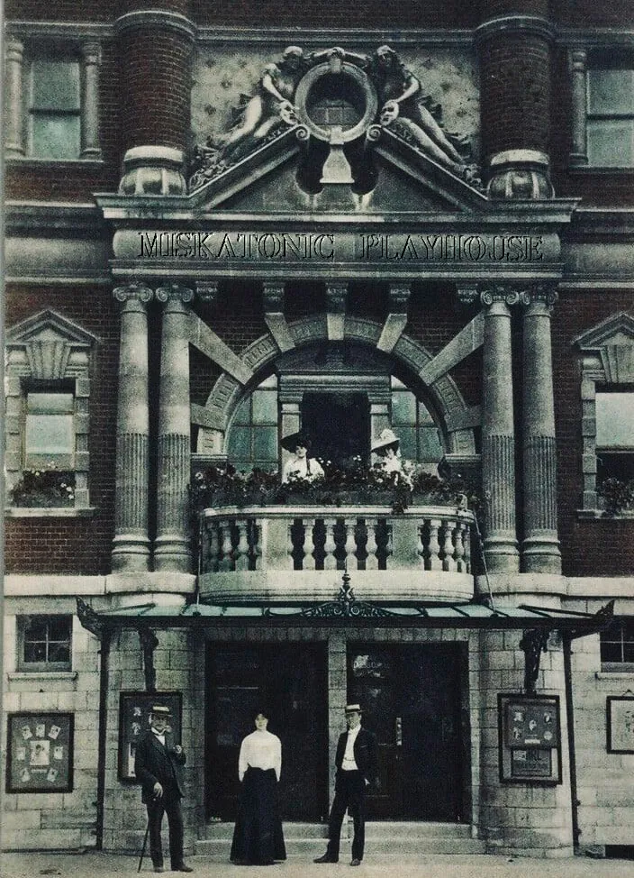

# Раздатки

*Ниже — каждая раздатка в оригинале (картинкой, для печати) и её перевод.*

## Раздатка «Сцена-1»

> **Раздатка «Сцена-1»: фотография Мискатоникского театра (1907)**
>
> *Старая фотография фасада театра: колонны, балкон с двумя дамами в шляпах, трое у входа. Надпись над входом:* **МИСКАТОНИКСКИЙ ТЕАТР** *(MISKATONIC PLAYHOUSE). Символов на камне ещё нет.*
