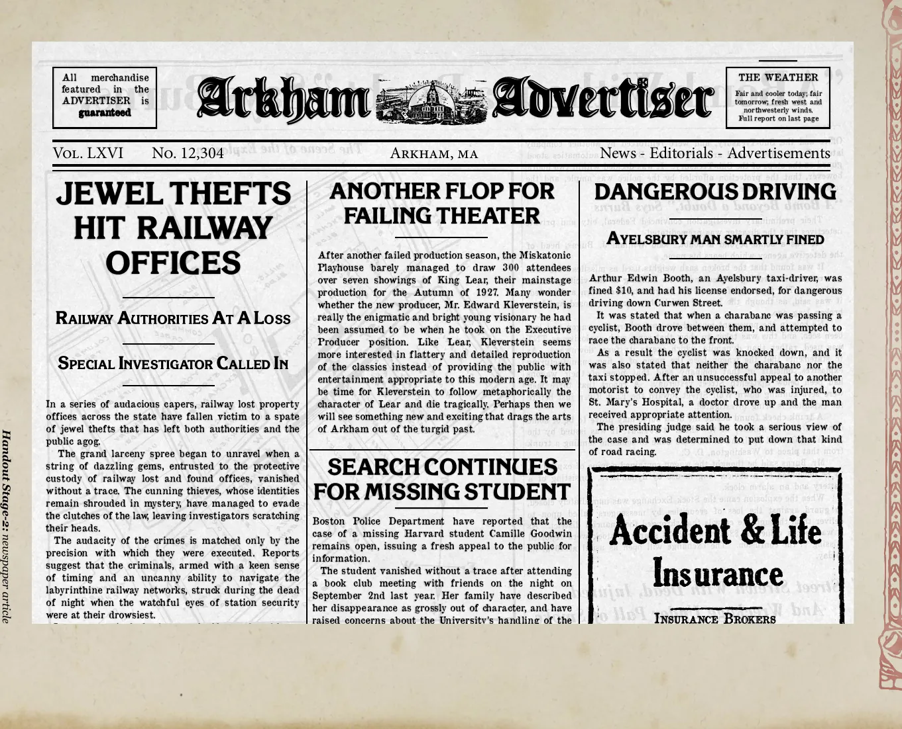

## Раздатка «Сцена-2»

> **Раздатка «Сцена-2»: газетная статья**
>
> *Все товары, рекламируемые в «АДВЕРТАЙЗЕРЕ», — с гарантией*
>
> ## Аркхэм Адвертайзер
>
> Т. LXVI · № 12 304 · Аркхэм, Массачусетс · Новости — Передовицы — Объявления
>
> **ПОГОДА.** Сегодня ясно и прохладнее; завтра ясно; свежий западный и северо-западный ветер. *Полная сводка — на последней странице.*
>
> ### КРАЖИ ДРАГОЦЕННОСТЕЙ В ЖЕЛЕЗНОДОРОЖНЫХ КОНТОРАХ
>
> **Железнодорожное начальство в растерянности. Вызван особый следователь**
>
> Серия дерзких налётов: бюро находок железной дороги по всему штату стали жертвами волны краж драгоценностей, которая повергла в изумление и власти, и публику.
>
> Грандиозная череда краж начала раскрываться, когда нитка ослепительных камней, вверенная бюро находок железной дороги на хранение, бесследно исчезла. Хитроумным ворам, чьи личности остаются окутаны тайной, удалось уйти от руки закона, оставив следователей ломать голову.
>
> Дерзость преступлений сравнима лишь с точностью их исполнения. По сообщениям, преступники, наделённые острым чувством времени и сверхъестественным умением ориентироваться в лабиринте железнодорожных сетей, наносили удар глубокой ночью, когда бдительные глаза станционной охраны особенно слипались.
>
> ### ЕЩЁ ОДИН ПРОВАЛ ГИБНУЩЕГО ТЕАТРА
>
> После очередного неудачного сезона Мискатоникский театр едва собрал 300 зрителей за семь показов «Короля Лира» — главной постановки осени 1927 года. Многие задаются вопросом, действительно ли новый продюсер, мистер Эдвард Клеверштейн, — тот загадочный и блестящий молодой провидец, каким его считали, когда он занял пост исполнительного продюсера. Подобно Лиру, Клеверштейн, похоже, больше любит лесть и дотошное воспроизведение классики, чем развлечения, подобающие нашему современному веку. Быть может, Клеверштейну пора, фигурально выражаясь, последовать за Лиром и трагически умереть. Возможно, тогда мы увидим что-то новое и захватывающее, что вытащит искусство Аркхэма из напыщенного прошлого.
>
> ### ПОИСКИ ПРОПАВШЕЙ СТУДЕНТКИ ПРОДОЛЖАЮТСЯ
>
> Полицейское управление Бостона сообщило, что дело о пропаже студентки Гарварда Камиллы Гудвин остаётся открытым, и вновь обратилось к публике за сведениями.
>
> Студентка бесследно исчезла после встречи книжного клуба с друзьями в ночь на 2 сентября прошлого года. Семья называет её исчезновение совершенно ей несвойственным и выражает сомнения в том, как университет ведёт…
>
> ### ОПАСНАЯ ЕЗДА
>
> **Эйлсберийца крупно оштрафовали**
>
> Артур Эдвин Бут, таксист из Эйлсбери, оштрафован на $10 с отметкой в правах за опасную езду по Кервен-стрит.
>
> Сообщается, что, когда шарабан обгонял велосипедиста, Бут проехал между ними и попытался обогнать шарабан.
>
> В результате велосипедист был сбит; сообщается также, что ни шарабан, ни такси не остановились. После безуспешной просьбы к другому автомобилисту отвезти раненого велосипедиста в больницу Святой Марии подъехал врач, и пострадавшему оказали надлежащую помощь.
>
> Председательствующий судья заявил, что относится к делу со всей серьёзностью и намерен покончить с подобными гонками на дорогах.
>
> **Страхование от несчастных случаев и жизни** — *Страховые брокеры*

*Прим. перев.: в статье — «осень 1927 года», хотя действие сценария идёт осенью 1923 года; оставлено как напечатано. Статьи о кражах и о студентке на полосе обрываются.*
