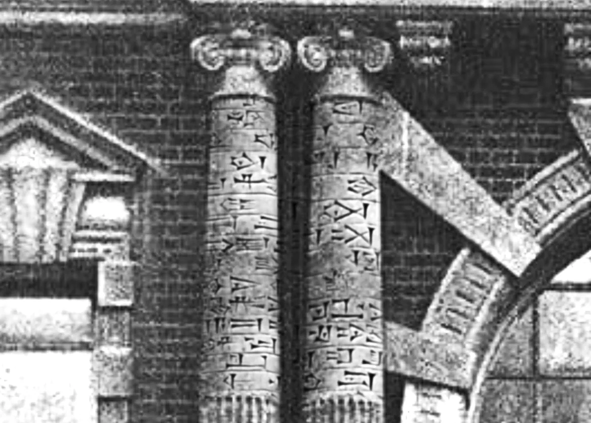

## Раздатка «Сцена-3»

> **Раздатка «Сцена-3»: резные символы**
>
> *Колонны у входа в театр, покрытые грубо вырезанными символами — теми же, что на внутренней стороне египетской шкатулки. Текста нет — только символы.*
