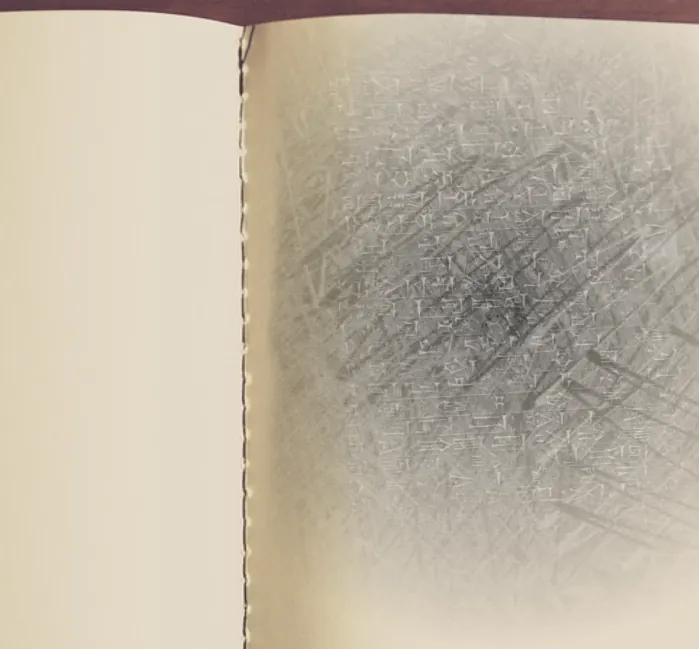

## Раздатка «Сцена-4»

> **Раздатка «Сцена-4»: блокнот**
>
> *Оттиск, снятый карандашом с верхнего листа блокнота Клеверштейна: символы, совпадающие с вырезанными на театре. Текста нет — только символы.*
