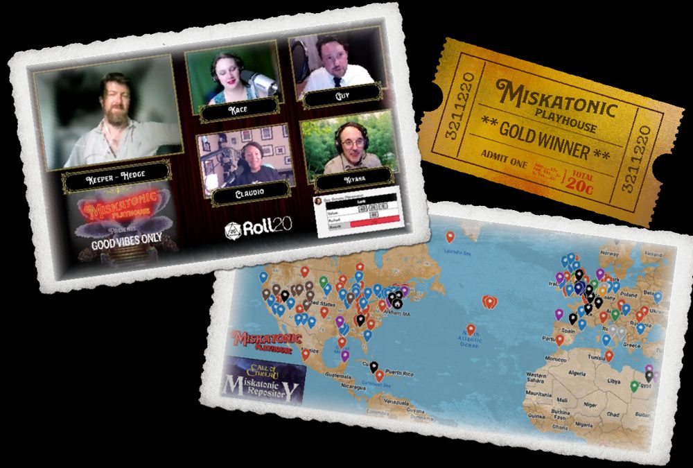

# Miskatonic Playhouse

**Miskatonic Playhouse** — подкаст, посвящённый сценариям для *«Зова Ктулху»*, созданным сообществом. Мы — место встречи писателей, художников и других авторов, работающих в жанре космического ужаса.

Мы — сообщество авторов: писателей, художников, игроков и редакторов. Мы рассказываем о сценариях из Miskatonic Repository — хранилища материалов, создаваемых сообществом для настольной ролевой игры *«Зов Ктулху»*.

Ещё мы ведём карту сценариев Miskatonic Repository (Miskatonic Repository Scenario Map), которая показывает поразительный размах и разнообразие сценариев Miskatonic Repository и мест их действия.

Подробнее — на сайте **www.MiskatonicPlayhouse.com**

*На коллаже — кадр онлайн-игры подкаста (Хранитель — Хедж; игроки Кейс, Гай, Клаудио, Кияна; «Miskatonic Playhouse presents Good Vibes Only», Roll20), золотой билет «Miskatonic Playhouse — Gold Winner — Admit One» и карта мира с отметками сценариев.*
