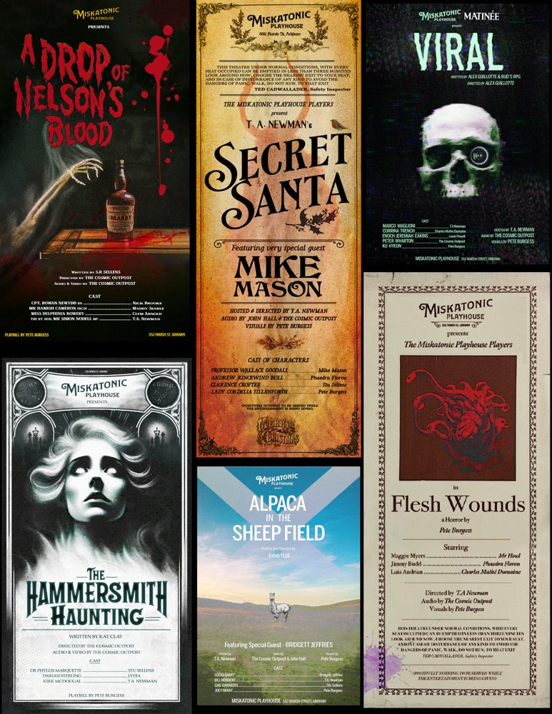

*Последняя страница — афиши других сценариев Miskatonic Playhouse (театр на Марш-стрит, 552, Аркхэм):*

- *«A Drop of Nelson’s Blood»* («Капля крови Нельсона») — автор С. Р. Селленс;
- *«Secret Santa»* («Тайный Санта») — Т. А. Ньюман, при особом участии Майка Мейсона;
- *«Viral»* («Вирусный») — Алекс Гийотт и Bud’s RPG;
- *«The Hammersmith Haunting»* («Призрак Хаммерсмита») — Кэт Клэй;
- *«Alpaca in the Sheep Field»* («Альпака на овечьем пастбище») — Джон Холл, при особом участии Бриджетт Джеффрис;
- *«Flesh Wounds»* («Раны плоти») — Пит Бёрджесс; в ролях — Мэгги Майерс, Джимми Бадд и Луис Андриан.

*На двух афишах — шуточное «правило безопасности» театра: в обычных условиях, когда заняты все места, зал можно освободить меньше чем за три минуты; оглянитесь, выберите ближайший к вам выход и в случае любых беспорядков, чтобы избежать паники, идите, а не бегите к этому выходу (подпись — Тед Кадуолладер, инспектор по безопасности); и «во время представления ничего не подаётся».*
