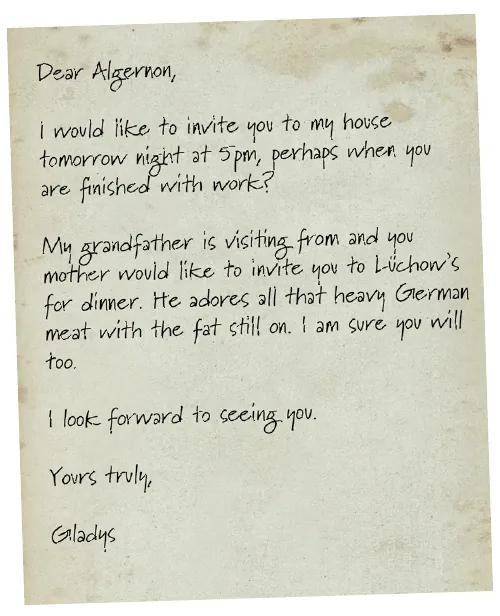

Кроме того, если вы записали ЗАПУГАН, ваше первое успешное попадание по существу выходит слабым, и его урон уменьшается на 2.

Если вы записали слова ПОЧТИ НЕЗАМЕТНО, вам удалось застать тварь врасплох, прежде чем она вас учуяла. Поставьте крысиную тварь на карте куда угодно; вы ходите первым.

*Если вы победили крысиную тварь, перейдите к **[7](#p7)**.*

*Если существо вас убило, хороших новостей нет. Через несколько месяцев машинисту поезда метро приходится экстренно остановиться на путях. Осмотрев тоннель, он находит разбросанные по земле ваши обглоданные кости. Он решает, что не стоит тратить время на рапорт.*

### 30

Вы быстро моргаете снова и снова, надеясь, что зрение вернётся раньше, чем по тоннелю пройдёт разряд! Но не видите ничего, кроме слепящих белых призраков. Вы вслепую тянетесь руками, нащупывая стены.

Вы вспоминаете рассказы о рабочих, обожжённых и страшно изувеченных, когда такой разряд заставал их врасплох. В газете напечатали снимок человека, которому такая аномалия выжгла глаза, а язык навсегда остался чёрным. Неужели вас ждёт та же участь?

*Пройдите проверку ВЫН. При успехе перейдите к **[45](#p45)**.*

*При провале перейдите к **[6](#p6)**.*

### 31

Когда двое мужчин уходят далеко, вы отдираете несколько досок, перегораживающих путь, и пролезаете под ними. Вы осторожно спрыгиваете в главный тоннель метро, стараясь шуметь как можно меньше.

Вы понимаете, что потеряли ориентацию. Вы должны быть где-то возле достроенной станции «Бруклин-Хайтс», но не знаете, на севере ли она, куда ушли мужчины, или позади вас, в тоннеле на юге.

*Если вы прошли проверку Ориентирования, перейдите к **[14](#p14)**.*

Иначе придётся угадывать.

*Если вы идёте на север, перейдите к **[49](#p49)**.*

*Если вы идёте на юг, перейдите к **[24](#p24)**.*

### 32

Безумец умирает у ваших ног, изо рта у него натекает лужа чёрной крови. Вы выбиваете ногой **зубило** из его руки (если подберёте его, считайте его кинжалом с уроном 1d4+БкУ).

К сожалению, во время схватки ваш фонарик упал, и теперь на его трубчатом корпусе большая вмятина.

Проверьте надёжность фонарика. *При провале перейдите к **[59](#p59)**.*

Посветив на тело, вы видите клочок бумаги, наполовину торчащий у него из-за пояса брюк. Вы наклоняетесь и рассматриваете записку. В ней написано:

> **Раздатка: записка Глэдис**
>
> Дорогой Элджернон,
>
> я бы хотела пригласить тебя к себе домой завтра вечером в 5 часов — может быть, когда ты закончишь работу?
>
> Ко мне в гости приезжает дедушка из [пропущено в оригинале], и мама хотела бы пригласить тебя на ужин в «Люхов». Он обожает всё это тяжёлое немецкое мясо с жирком. Уверена, тебе тоже понравится.
>
> С нетерпением жду встречи.
>
> Искренне твоя,
>
> Глэдис

*Прим. перев.: в записке пропущено, откуда приезжает дедушка («visiting from and you mother»), и, видимо, «you mother» напечатано вместо «my mother».*

Теперь вы точно вспоминаете, что **Элджернон Карсон** был одним из пропавших. Но правда ли это Элджернон Карсон — или просто безумец, присвоивший его имя? Вряд ли кого-то настолько неуравновешенного пригласили бы в такой приличный ресторан, как «Люхов»…

Бросив последний взгляд на странную скульптуру на стене, вы разворачиваетесь и возвращаетесь к развилке тоннеля. На этот раз вы сворачиваете направо в надежде, что этот путь выведет вас отсюда.

*Перейдите к **[36](#p36)**.*
