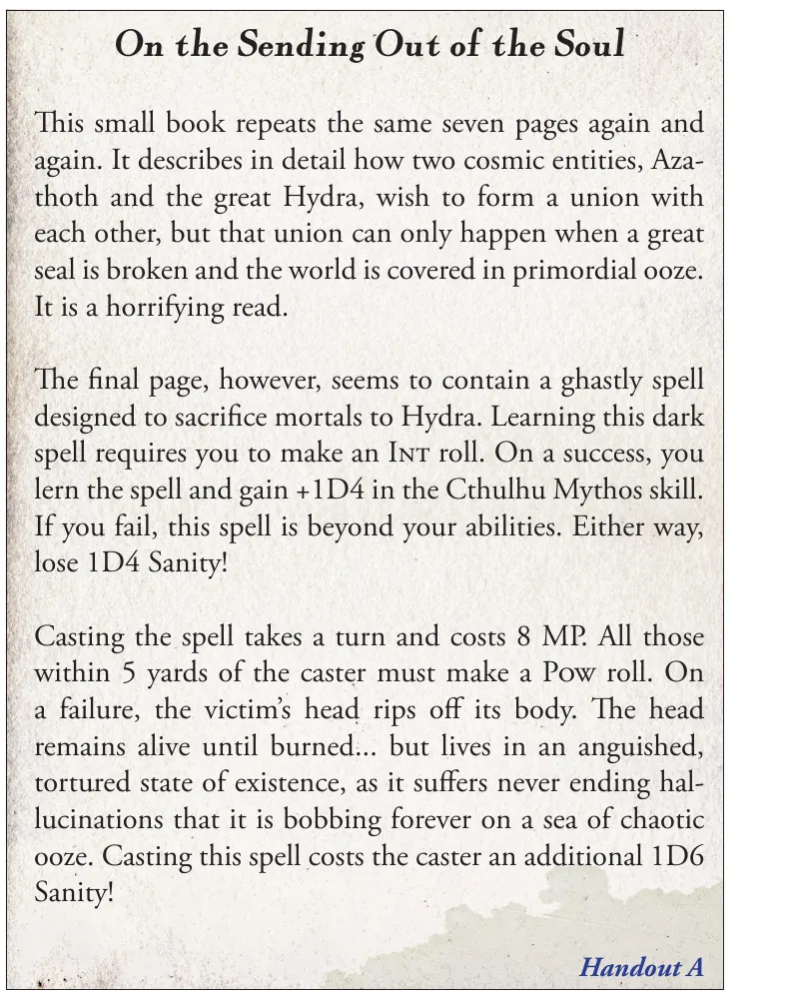

#### Мистер Гиттингс

*[иллюстрация]*

```stat
СИЛ 80    ИНТ 60
ВЫН 60    МОЩ 60
ТЕЛ 80
ЛВК 60

ПЗ: 14           БкУ: +1d4
Комплекция: 1    Скорость: 7

Атак за раунд: 1
Драка        55% (27/11), урон 1d3+БкУ
Молот        60% (30/12), урон 1d10+БкУ
Уклонение    30% (15/6)

Снаряжение: Циклопический молот (урон 1d10+БкУ). Молот наносит дополнительный урон противникам с низким Рассудком (см. основной текст).

Тактика: так близко к цели мистер Гиттингс атакует яростно, надеясь убить молотом с одного удара. Но если сыщик сбит с ног или вне досягаемости, он вместо этого бежит ломать печать.
```

*Прим. перев.: Скорость 7 — как в оригинале; по правилам 7-й редакции при СИЛ 80 = ТЕЛ 80 и ЛВК 60 выходит 8 (возраст не указан).*

#### Культист Азатота

*[иллюстрация]*

```stat
СИЛ 55    ИНТ 40
ВЫН 40    МОЩ 40
ТЕЛ 45
ЛВК 60

ПЗ: 8            БкУ: +0
Комплекция: 0    Скорость: 9

Атак за раунд: 1
Драка        35% (17/7), урон 1d4+БкУ
Стрельба     40% (20/8), урон 1d8
Уклонение    30% (15/6)

Снаряжение: у одного из культистов всегда есть французский револьвер MAS 1892 (урон 1d8, дальность 15 м, выстрелов за раунд 1 (3), патронов 6, осечка 100). Все вооружены небольшими ножами (урон 1d4+БкУ).

Тактика: культисты пытаются окружить противника, а затем атакуют. Если мистер Гиттингс ранил сыщика, на следующий ход культисты по возможности бросаются в атаку, надеясь его добить.
```

#### Джузеппе

*[иллюстрация]*

```stat
СИЛ 60    ИНТ 50
ВЫН 50    МОЩ 45
ТЕЛ 55
ЛВК 65

ПЗ: 10           БкУ: +0
Комплекция: 0    Скорость: 8

Атак за раунд: 1
Драка        40% (20/8), урон 1d4+БкУ
Стрельба     25% (12/5)
Уклонение    30% (15/6)

Снаряжение: складной нож (урон 1d4+БкУ).

Тактика: Джузеппе осторожен и боится людей в тоннелях. Он не станет нападать на мистера Гиттингса, пока культисты не побеждены. Он никогда не атакует безрассудно и предпочитает драться от обороны.
```

*Прим. перев.: у драки в оригинале напечатано «40% (28/8)»; здесь половина для 40%. Скорость 8 и Уклонение 30% — как в оригинале, хотя по правилам при СИЛ 60 и ЛВК 65 больше ТЕЛ 55 Скорость 9, а Уклонение начинается с половины ЛВК (32%).*



> **Раздатка A: «Об отсылании души»**
>
> **Об отсылании души**
>
> Эта небольшая книга снова и снова повторяет одни и те же семь страниц. Она подробно описывает, как две космические сущности, Азатот и великая Гидра, хотят соединиться друг с другом, но этот союз возможен, лишь когда будет сломана великая печать и мир покроет первобытная слизь. Чтение ужасное.
>
> Однако на последней странице, похоже, записано жуткое заклинание для принесения смертных в жертву Гидре. Чтобы выучить это тёмное заклинание, пройдите проверку ИНТ. При успехе вы выучиваете заклинание и получаете +1d4 к навыку Мифы Ктулху. При провале заклинание вам не по силам. В любом случае потеряйте 1d4 Рассудка!
>
> Сотворение заклинания занимает ход и стоит 8 ПМ. Все в пределах 5 метров от заклинателя должны пройти проверку МОЩ. При провале голова жертвы отрывается от тела. Голова остаётся живой, пока её не сожгут… но живёт в мучительном, истерзанном состоянии, страдая от бесконечных галлюцинаций, будто она вечно качается на море хаотической слизи. Сотворение заклинания стоит заклинателю ещё 1d6 Рассудка!
>
> *Раздатка A*
