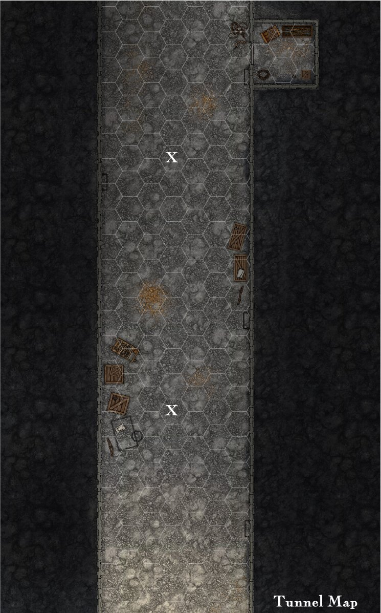

## Карта тоннеля

*На карте: шестигранная сетка вдоль тоннеля, две отметки X — места противника и сыщика в боях с культистом (абз. 3), крысиной тварью (абз. 29) и скульптором (абз. 42); в правом нижнем углу подпись «Tunnel Map» — «Карта тоннеля».*