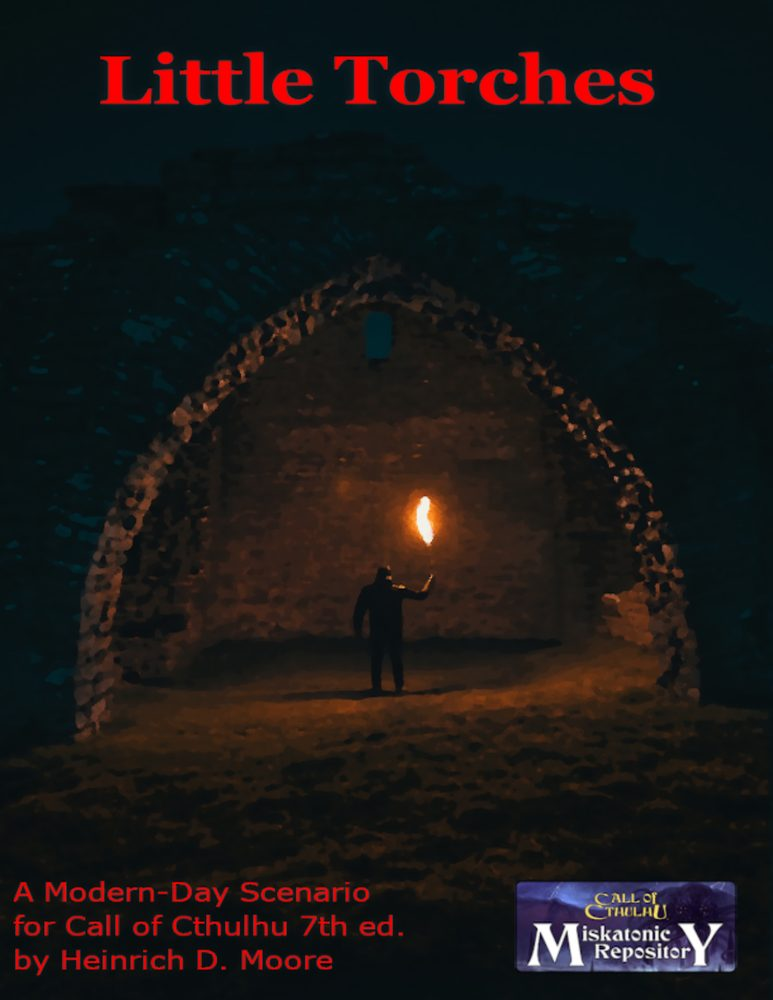

МАЛЕНЬКИЕ ФАКЕЛЫ

Генрих Д. Мур

*На обложке — фигура с горящим факелом под каменной аркой руин маяка в ночи; вверху — название «Little Torches», внизу — «Сценарий в наши дни для „Зова Ктулху“, 7-я редакция; автор — Генрих Д. Мур (Heinrich D. Moore)» и логотип «Call of Cthulhu — Miskatonic Repository».*
