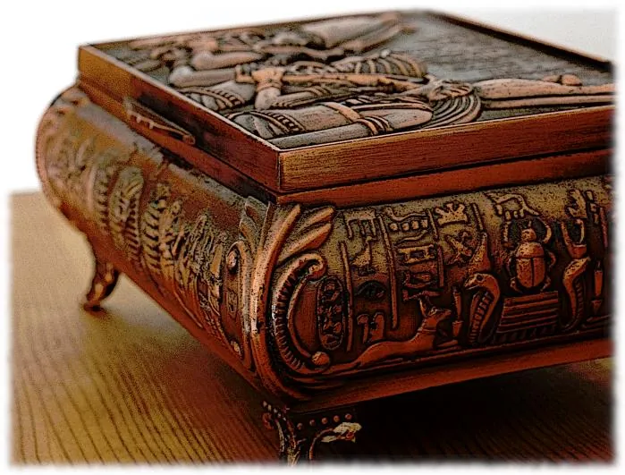

Когда смерть родителей признали несчастным случаем, Харпер удочерила её тётя, известный археолог **Бану Нор** (о чём Харпер не знала — тоже приверженка культа Ктулху). Благодаря поездкам приёмной матери Харпер повидала немалую часть мира, и особенно Ближний Восток, где она бывала с тётей на нескольких раскопках. С Ктугхой Харпер соприкоснулась на раскопках у руин Атешгяха — храма огня в Баку (Азербайджан). Найдя среди артефактов, раскопанных тётей, бронзовый ларец, который она позже станет называть «Киносурой», Харпер вступила в общение с Ктугхой, и оно убедило её, что Мифам Ктулху нужно противостоять, чего бы это ни стоило.

Харпер ещё не раз возвращалась на Ближний Восток, даже пока получала степени по психиатрии. Всё это время она продолжала впитывать учение Ктугхи и привозила из тех краёв артефакты (некоторые тайком взяла из коллекции приёмной матери). Закончив учёбу и ординатуру, она на семейное наследство открыла **Институт психиатрических исследований и лечения «Дедал»** — психиатрическое заведение, специализирующееся на депрограммировании бывших членов культов. В годы перед началом расследования Харпер лечила своих пациентов с помощью Киносуры и воспитала целый отряд готовых на всё «маленьких факелов», которых может посылать против угроз Мифов. Харпер не уверена, действительно ли её пациенты после смерти становятся частью Ктугхи, но верит, что их жертва укрепляет Ктугху и что это единственный путь, которым человечество может противостоять силам Мифов.

## Киносура

В центре «Маленьких факелов» — артефакт, известный как **Киносура**; сыщики должны найти его в начале расследования. Открыть артефакт, заглянуть внутрь и запустить описанную ниже цепь событий — без этого сыщики не смогут успешно завершить расследование. Поэтому сыщикам нужно дать все возможности найти Киносуру и подталкивать их к опытам с ней, в том числе с помощью проверок **Идеи**.

Сама Киносура выглядит как небольшой ларец, отлитый из бронзы, тёплый на ощупь. Снаружи на нём изображено пламя, но при внимательном осмотре видны два ряда фигур, обращённых друг к другу, — их руки сходятся, сжимая огненный шар. Артефакт датируется примерно VII веком до н. э., а мотив, по-видимому, сильно навеян протозороастрийской символикой. На внешней стороне ларца нет и следа того разрушения, какого можно ждать от бронзового предмета такого возраста. Если открыть ларец, внутри в неглубокой выемке горит пламя, едва ли больше свечного. Ни источника топлива, ни механизма поджига не видно. На самом деле пламя горит всегда, даже когда артефакт закрыт: это искра Великого Древнего, Ктугхи.

Попытки уничтожить Киносуру физической силой — разве что кроме промышленного мусорного пресса или чего-то подобного — ни к чему не приводят. Жар и огонь Киносуре не страшны. Разрушить бронзовый артефакт химическими или магическими средствами можно, но любому, кто за это возьмётся, следует разрешить проверку **Мифов Ктулху**, **Оккультизма** или **Идеи**, чтобы он понял: разрушение артефакта может не перерезать проход, а расширить его — и, возможно, призвать самого Ктугху. Упорствующих сыщиков ждёт награда — взрыв, уничтожающий всё в радиусе 1d6×1,6 км (1d6 миль), а вдвое большую площадь накрывает смертельная доза радиации.

### Искра Ктугхи

Открыть Киносуру само по себе не стоит пунктов **Рассудка**, но любой, кто это сделает, рискует быть заворожённым пламенем Ктугхи, которое гипнотически меняет яркость и даже цвет.

Наблюдатели, которые сознательно стараются не смотреть на пламя, должны пройти проверку **МОЩ**. Прошедшие её могут отвести взгляд, но каждая следующая попытка отвернуться потребует новой проверки **МОЩ** — сначала трудной, а затем чрезвычайной. Провалившие проверку **МОЩ** или сами решившие заглянуть в Киносуру делают проверку **Рассудка** (1/1d3) и не могут отвести взгляд следующие 1d10 минут — всё это время они заворожены. Если этого не случалось раньше, они также становятся **отмеченными Ктугхой** и входят в сновидческое видение (см. **часть III. Сны о Маяке**). Кроме того, они теряют столько пунктов магии, сколько минут были заворожены.

Через 1d10 минут наблюдатели, которых не оттащили от Киносуры и которые всё ещё смотрят на открытое пламя, должны пройти проверку **МОЩ**. Провал означает, что наблюдатель смотрит на пламя ещё 1d10 часов и теряет столько пунктов магии, сколько часов выпало. Если в конце этого срока взгляд наблюдателя всё ещё прикован к пламени, он делает ещё одну проверку **МОЩ**; провал означает, что он будет смотреть на пламя 1d10 дней и за это время без медицинской помощи, скорее всего, умрёт от обезвоживания. Он также теряет столько пунктов магии, сколько дней выпало.
