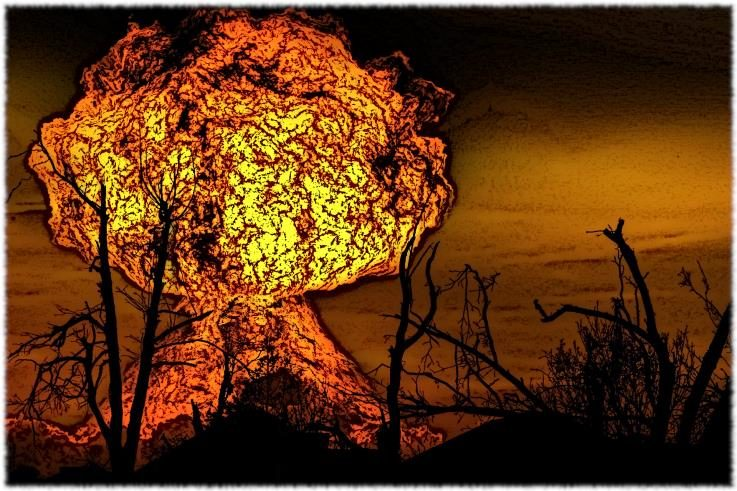

Пункты магии, потерянные из-за Киносуры, теряются соответствующими порциями (минуты, часы, затем дни). При этом заворожённые наблюдатели не восстанавливают пункты магии. Наблюдатели, потерявшие все пункты магии, остаются заворожёнными. Если их взгляд силой не оторвать от Киносуры, то по истечении выпавшего срока внутри них проявятся 1d3 огненных вампира и прожгут себе путь наружу, убив наблюдателя. По решению Хранителя, глядя в Киносуру, сыщики могут видеть сны и видения о Ктугхе, в том числе описанные ниже.

### Отмеченный Ктугхой

На протяжении всех «Маленьких факелов» сыщики рискуют подвергнуться разрушительному влиянию Ктугхи и стать **отмеченными Ктугхой** — в том числе когда впервые заглянут в Киносуру. Пациенты института «Дедал», получающие сомнительное благо заботы доктора Харпер, могут отсрочить наступление этих эффектов, но сыщикам так не повезло. Каждый раз, когда с сыщиком случается событие, после которого он становится «отмеченным Ктугхой», он получает следующую карточку из серии раздаток (**раздатка 1–4. Отмеченный Ктугхой**). Каждая сопровождается чувством, которое испытывает сыщик. Каждая также сопровождается всё более тяжёлыми игровыми эффектами, хотя они проявятся не сразу.

## Вступление для сыщиков

«Маленькие факелы» начинаются с того, что сыщики находятся в **колледже Кроули** или рядом с ним. Это небольшой университет возле **Санта-Розы** — города, приютившегося между крупными городами: Сан-Франциско на юге и Сакраменто на востоке. Причин оказаться в университете у сыщиков может быть много. Сыщики могут выступать с лекцией или слушать её, навещать коллег по работе или друзей-студентов. Сыщики, находящиеся в университете, встретят Кэти Белл, когда она войдёт в здание и подожжёт себя. Сыщикам, которых там нет, нужно дать возможность вмешаться, как только станет ясно, что в колледже пожар.

Возможно, сыщики знали Белл и до событий «Маленьких факелов» (см. **приложение C**), хотя это не обязательно. Даже сыщики из других мест, скорее всего, слышали о юной девушке, которую похитила собственная мать, и о том, как девушку спасли после перестрелки и пожара в комплексе, где её удерживал какой-то культ.

После событий первой сцены (см. **«Колледж Кроули»**) городские власти могут поручить сыщикам с подходящим прошлым расследовать, не причастна ли Белл к пожару. Других сыщиков могут привлечь как консультантов. Или же сыщиков могут нанять адвокаты, представляющие семьи студентов, пострадавших и погибших при пожаре, чтобы расследовать пожар для судебного иска. Наконец, у сыщиков, знавших Белл или её семью, может быть личный интерес — выяснить причину её смерти.

## Вступление для Хранителя

Кэти Белл — последняя по времени пациентка доктора Эйнсли Харпер. После того как Белл спасли из культа, известного как «Школа Сна» (см. **раздатку 12. Похищение и спасение Кэти Белл**), её направил в институт «Дедал» под опеку доктора Харпер бывший пациент «Дедала», полицейский **Харлем Бэнкс**. После двух месяцев интенсивного стационарного лечения в институте, включая повторные сеансы с Киносурой, Харпер по просьбе отца отпустила Белл домой под его опеку. Харпер не знала, что Белл забрала Киносуру с собой. Через две недели Белл возвращается в колледж Кроули и поджигает себя, призвав огненных вампиров и разрушив часть колледжа. Смерть Белл и масштаб причинённых ею разрушений застают Харпер врасплох. Появление сыщиков — ещё одно нежеланное осложнение.

Дальнейшее расследование во многом зависит от действий сыщиков и ответов на них Харпер. Поэтому описанная здесь последовательность — лишь один из возможных путей, и вполне возможно (и даже вероятно), что сыщики пойдут другой дорогой.

В части II, надеемся, пережив пожар в колледже Кроули, завладев Киносурой и получив официальное или неофициальное поручение расследовать обстоятельства смерти Белл, сыщики, скорее всего, начнут расследование с разговора с семьёй Белл. От её отца, **Марка Белла**, они узнают, что Кэти Белл лечилась в институте «Дедал» и не ходила на занятия со времени похищения. Они могут также найти дневник Кэти Белл (**раздатка 11. Выдержки из дневника Кэти Белл**) с упоминаниями Маяка — и саму Киносуру, если ещё не забрали её с тела Белл. Оттуда сыщики, скорее всего, направятся в институт «Дедал».

*Прим. перев.: так в оригинале — «В части II»; разговор с семьёй Белл и дневник описаны в части I (с. 12–13).*
