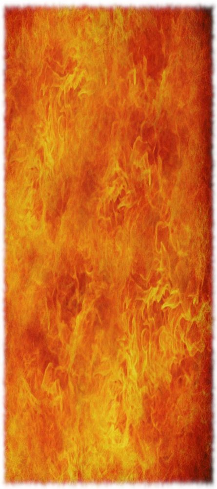

### Текущие события

- **6 января 1994 года.** Мать похищает Кэти Белл и увозит её в Школу Сна, которая действует в остатках усадьбы «Камелия».
- **8 января 1994 года.** Полиция выслеживает Белл и её мать до усадьбы «Камелия» и Школы Сна. Когда забаррикадировавшиеся культисты отказываются продолжать переговоры, полиция штурмует поместье. Возникший пожар, устроенный бывшей пациенткой «Дедала» Ханной Колфилд, внедрившейся в культ, прицельно убивает членов Школы Сна. После спасения Белл направляет в институт «Дедал» полицейский Харлем Бэнкс, сам бывший пациент «Дедала».
- **28 апреля 1994 года.** По просьбе отца, Марка Белла, Белл отпускают из института «Дедал» домой, чтобы начать амбулаторное лечение. Она тайком крадёт из института Киносуру.
- **10 мая 1994 года.** Начинается расследование: Кэти Белл возвращается в колледж Кроули и сжигает себя.

### Возможные будущие события

- **11 мая 1994 года.** Сыщикам поручают, официально или нет, расследовать смерть Кэти Белл.
- **12–13 мая 1994 года.** Сыщики беседуют с отцом Белл, Марком Беллом, узнают об институте «Дедал» и находят Киносуру. Сыщики посещают институт «Дедал» и беседуют с доктором Харпер. Они могут также поговорить с приёмной матерью Харпер, профессором Бану Нор.
- **14 мая 1994 года.** Пациентка «Дедала» Флоренс «Фло» Сандерс по приказу Харпер пытается убить сыщиков, сжигая себя. Нор читает в колледже Кроули лекцию «Наследники света».
- **15–20 мая 1994 года и позже.** Сыщики продолжают расследование. Они могут подробнее исследовать институт «Дедал» и усадьбу «Камелия». Сыщики могут помешать пациентам Харпер сжечь себя. Заглянув в Киносуру, сыщики исследуют Маяк изнутри в сновидческом мире и сталкиваются с Харпер.

