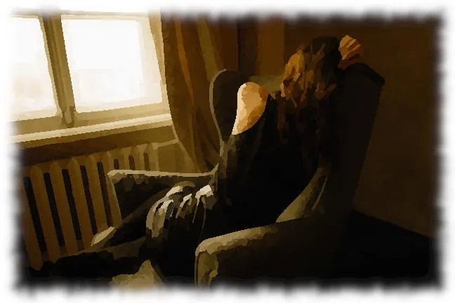

## Семья Белл

Отец Кэти Белл, **Марк Белл**, управляющий в местном банке, живёт в доме в пригороде, недалеко от колледжа Кроули. К тому времени, как сыщики с ним заговорят, полиция уже сообщит ему о смерти дочери.

Белл согласится встретиться с сыщиками, но он всё ещё в шоке. На вопросы он отвечает то безучастно, то с недоверием. В зависимости от того, сколько и как напористо сыщики будут его расспрашивать, он может не выдержать и сломаться прежде, чем сыщики закончат беседу.

### Похищение Кэти Белл и Школа Сна

Марк Белл и его жена **Эленор** поженились вскоре после рождения дочери. Супруги отдалились друг от друга, когда Эленор Белл ушла в живопись и всё глубже погружалась в «Школу Сна».

То, что поначалу казалось безобидным духовным кружком с лайф-коучингом и дневниками сновидений, оказалось чем-то куда более зловещим. Через два года регулярных поездок на еженедельные ретриты группы в **усадьбу «Камелия»** — историческое здание, купленное Школой Сна, — и примерно за четыре месяца до начала расследования Эленор Белл исчезла вместе с дочерью.

Кэти Белл была первокурсницей колледжа Кроули. Друзей она, похоже, заводила мало, кроме девушки по имени Скай Медоус, и, когда мать её похитила, она всё ещё жила дома.

Марк Белл сразу же обратился в полицию. Полиции не понадобилось много времени, чтобы выследить Эленор Белл до усадьбы «Камелия». Последовало двухдневное противостояние, закончившееся штурмом здания полицией. Белл знает, что вспыхнул пожар, в котором погибли все члены Школы Сна, в том числе его жена. Кэти Белл, к счастью, спасли. Если спросить, почему он считает похищение насильственным, Марк Белл не верит своим ушам и не в силах допустить иного.

### Институт «Дедал»

Кэти Белл всю жизнь страдала депрессией; Марк Белл признаёт, что эмоциональная отстранённость родителей делу не помогала. Кэти Белл однажды пыталась покончить с собой, наглотавшись снотворного, а в другой раз — вскрыв вены. После того как её спасли из Школы Сна, отец решил, что ей нужна профессиональная помощь, и полиция (а именно офицер Харлем Бэнкс) направила её в институт «Дедал».

Институт сразу же произвёл на отца Кэти Белл сильное впечатление: там смогли сразу же принять его дочь. Навещая её в следующие месяцы, он всякий раз видел, насколько лучше и счастливее она выглядит. Около двух недель назад он попросил отпустить её домой, но теперь боится, что, забрав её из института до окончания стационарного лечения, он виновен в смерти дочери.

### Последнее утро Кэти Белл

Кэти Белл не собиралась возвращаться к учёбе. Утром во вторник, 10 мая, ничего необычного не происходило, разве что настроение у неё было особенно хорошее.

### Мастерская Эленор Белл

Сыщики могут захотеть просмотреть вещи матери Кэти Белл, Эленор. Однако всё, что она не перевезла в Школу Сна в усадьбу «Камелия» (и что потом сгорело при пожаре), Марк выбросил. Её мастерская осталась, хотя большинство работ там написаны ещё до того, как она слишком увлеклась Школой Сна. Обыскав мастерскую, сыщики найдут множество акварелей с изображением бездонных подводных глубин и затонувших городов.

### Комната Кэти Белл

Марку Беллу явно не по себе от такого предложения, но он позволит сыщикам обыскать спальню дочери. После пожара он туда заходил, но ничего из её вещей не трогал.

На первый взгляд в комнате Кэти Белл есть все обычные приметы комнаты девочки-подростка. Но при внимательном осмотре (или по проверке **Идеи**) видно, что плакаты со знаменитостями и группами на стенах устарели на несколько лет. Вся комната кажется такой, будто здесь давно никто не жил. Целенаправленный обыск или подходящие проверки навыков обнаружат следующее.

- **Стол.** Стол Белл в безупречном порядке. Если сыщики не забрали Киносуру у Белл во время пожара (или им не передали её как улику после пожара), бронзовый ларец будет лежать посередине стола: его оставил там Марк Белл, получивший ларец от властей.
- **Шкаф.** В шкафу Белл — одежда с логотипом института «Дедал» (простые чёрно-белые рубашка и брюки с эмблемой чёрного солнца).
