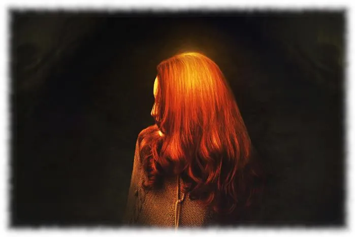

- **Последние слова Кэти Белл.** Если сыщики сумеют хотя бы приблизительно передать последние слова Белл, профессор Нор переведёт «Y'ah nafl mguh'e, Y'ah fm'latghor» как «Я не одна, я — пламя». Нор может также пояснить, что это, вероятно, религиозное песнопение, которым пользовались так называемые примитивные культуры по всему Ближнему Востоку. Возможно, смысл песнопения отсылает к символике, в которой община огнепоклонников видела себя не отдельными людьми, а единой сплочённой общиной, — но это лишь догадка Нор.
- **Лекция «Наследники света».** Нор специализируется на изучении Ближнего Востока, особенно Месопотамии и района нынешнего Ирана. Её лекция на самом деле посвящена раскопкам середины 80-х годов в до- или протозороастрийских руинах в Азербайджане, у храма огня Атешгях, известного надписями зороастрийского, мусульманского и индуистского происхождения. Нор предполагает, что находки раскопок указывают на существование совершенно отдельной культуры огнепоклонников, которая могла стать предтечей связанных с огнём ритуалов и космологии более поздних религий, в том числе исторического и современного зороастризма.
- **Доктор Эйнсли Харпер.** Если её прямо спросить, Нор признает, что Харпер — её приёмная дочь, хотя после раскопок в Азербайджане в 1985 году они почти не общались.

> *Простите, что говорю это, — я вовсе не хочу сказать, что вы сделали что-то не так, — но вы ведь понимаете, что этому на самом деле место в музее?*
>
> — Бану Нор

### «Наследники света»

Лекция профессора Бану Нор «Наследники света» назначена на 14 мая (через четыре дня после пожара в колледже), но может пройти тогда, когда это удобнее всего. Сыщикам не обязательно её посещать, но, в зависимости от хода расследования, Хранитель может использовать лекцию Нор, чтобы восполнить пробелы, которые сыщики могли упустить в своих изысканиях. Лекция может также стать запасной целью для любого из «маленьких факелов» Харпер (см. **часть III. Сны о Маяке**).

Лекция проходит в выставочном зале колледжа Кроули, где в стеклянных витринах выставлено несколько предметов, похожих на Киносуру. Нор расскажет о находках с нескольких раскопок в Атешгяхе и вокруг него в Азербайджане. Она выдвинет гипотезу о существовании сплочённого религиозного культа огнепоклонников, более древнего, чем зороастризм и другие современные религии. По словам Нор, люди этой культуры приносили человеческие жертвы и жили в состоянии почти непрерывной войны с соседними культурами. Нор предположит далее, что отдельные черты религиозных обрядов этой культуры, возможно, сохранились в некоторых современных культах в отдельных частях Индии, а может быть, и в Соединённых Штатах, и в качестве возможного примера приведёт гибель Школы Сна в огне (хотя сама Нор знает, что на деле эта группа была связана с культом Ктулху).

## Доктор Эйнсли Харпер

После разговора с отцом Кэти Белл или со Скай Медоус либо с профессором Нор сыщики, скорее всего, доберутся до Института психиатрических исследований и лечения «Дедал», чтобы поговорить с доктором Эйнсли Харпер. Первый визит сыщиков, скорее всего, ограничится разговором с Харпер в её кабинете. Если позже сыщики вернутся в институт, чтобы осмотреть его подробнее, см. **часть II. Институт «Дедал»**.

Институт «Дедал» открыл свои двери 11 октября 1989 года. Финансируемый наследством покойных родителей Харпер и деньгами от продажи усадьбы «Камелия», институт заслужил репутацию заведения, которое лечит психические расстройства жертв культов. Методы лечения в институте самые разные: индивидуальная и групповая терапия, стационарное и амбулаторное лечение, рецептурные лекарства и даже электросудорожная терапия и гидротерапия. Институт пользуется хорошей репутацией в психиатрическом сообществе, хотя там его считают нишевой диковинкой.

Широкой публике не известно, что институт «Дедал» — венец усилий Харпер в борьбе с Мифами Ктулху. Институт оказывает жизненно важную помощь тем, кто получил психологические травмы от Мифов, но в то же время служит вербовочным пунктом для личного крестового похода Харпер против Мифов Ктулху.

