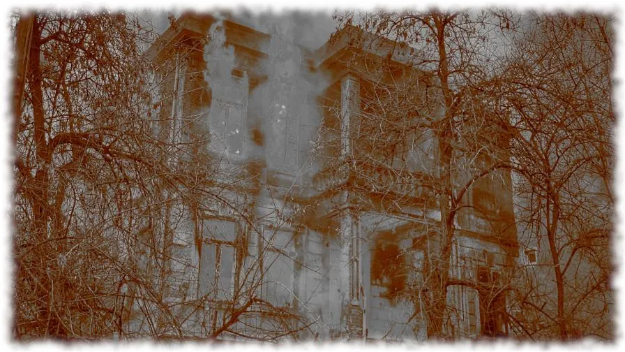

подробнее раскрыть историю Маяка и описать, как им пользовались глубоководные и их союзники-люди.

> **Раздатка 14. Усадьба «Камелия» вновь открыта**
>
> *«Реставрация усадьбы „Камелия“ завершена»*  
> *«Рипабликан» (1 января 1949 года)*
>
> *Семья Харпер с размахом отметила окончание реставрации исторической усадьбы «Камелия» на новогоднем празднике в пятницу. Гостей не смутила репутация Харперов как так называемых «оккультистов», хотя ваш корреспондент признаёт, что Брэндон и Ширин Харпер носят этот ярлык с гордостью и не скрывают былой связи с так называемой «Ложей Агапе» и переписки с бизнесменом и учёным Джеком Парсонсом. На празднике, безусловно, хватало необычных и удивительных принадлежностей. Но всё это было в шутку, и гостям явно понравилась вакхическая атмосфера, которую создали хозяева, а также экскурсия по ранее запечатанным туннелям бутлегеров под поместьем и по его знаменитому «Маяку».*

- **Доктор Эйнсли Харпер.** При успешной проверке навыка сыщики могут найти основные сведения о Харпер: дату рождения (11 октября 1950 года), высшее образование (бакалавр психологии, колледж Кроули, 1974), докторантуру и ординатуру (доктор остеопатической медицины, колледж Кроули, 1979) и послужной список (среди прочего — Департамент исправительных учреждений Калифорнии). Трудный успех откроет к тому же газетные статьи о гибели родителей Харпер (см. **раздатку 13. Пожар в усадьбе «Камелия»**). Чрезвычайный успех откроет к тому же сведения о её родителях (см. **раздатку 14. Усадьба «Камелия» вновь открыта**), а также то, что Харпер удочерила её тётя, Бану Нор, профессор колледжа Кроули.
- **Институт «Дедал».** Обычного успеха достаточно, чтобы сыщики узнали: строительство института началось в 1988 году и закончилось в 1989-м. Институт оказывает стационарную и амбулаторную помощь при целом ряде психических расстройств. При трудном успехе сыщики узнают к тому же, что институт заслужил репутацию заведения, помогающего жертвам похищений и заложникам. Но больше всего он известен тем, что консультирует и депрограммирует бывших членов религиозных культов, помогая им выйти из них. Чрезвычайный успех даёт сыщикам план здания, а также сведения о том, что строительство осложнила геологическая нестабильность фундамента (иными словами, природные пещеры, которые пришлось залить бетоном).
- **Ктугха.** Обычный успех покажет, что слово «Ктугха» обозначает божество, смутно связанное с огнепоклонством, особенно у сект Ближнего Востока, существовавших ещё до зороастризма (около 700 года до н. э.). Ктугха как божество или космологическое понятие связан с огнём, чистотой, разрушением, очищением и общностью. Обычный успех откроет к тому же, что профессор Бану Нор 14 мая 1994 года читает в колледже Кроули лекцию о зороастризме под названием «Наследники света». Трудный успех покажет, что поклонение Ктугхе дожило до наших дней, по крайней мере по рассказам: ходят слухи, что секты огнепоклонников приносили человеческие жертвы в отдельных частях Индии ещё лет пятьдесят назад. Чрезвычайный успех покажет, что секты, связанные с Ктугхой, определяли себя через противостояние другим маргинальным религиозным сектам, и насилие между ними задокументировано.

