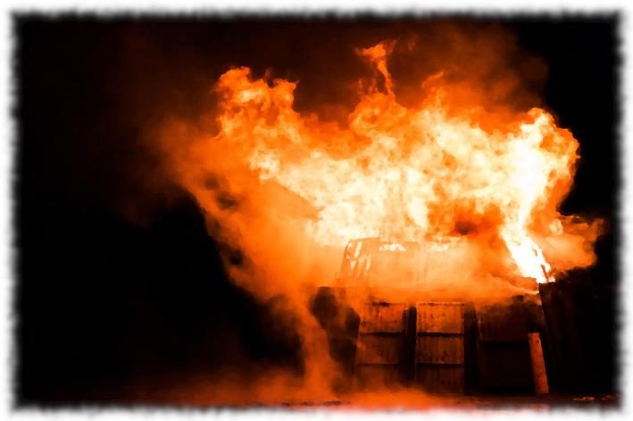

# Часть II. Ответный удар

> *Одни твердят: мир кончится огнём,*  
> *Другие — льдом.*  
> *Я страсть изведал на вкус — и потому*  
> *Стою за тех, кто держится огня.*  
> *Но если миру гибнуть дважды суждено,*  
> *То ненависти знаю я довольно,*  
> *Чтоб молвить: для разрушения и лёд*  
> *Хорош вполне*  
> *И справится вполне.*
>
> — Роберт Фрост, «Огонь и лёд» (Fire and Ice)

Часть II начинается, когда сыщики поняли, что доктор Харпер, Кэти Белл и институт «Дедал» связаны, открыли Киносуру и начали исследовать Маяк. Встревоженная успехами сыщиков, Харпер приказывает одной из своих пациенток устранить их. Остальная часть II описывает места, которые сыщики могут посетить после нападения (если ещё не побывали там), чтобы найти улики и остановить Харпер.

## Полуночный визит

По приказу Харпер или, возможно, по собственному почину пациентка «Дедала» **Флоренс «Фло» Сандерс** (с которой сыщики могли встретиться во время первого визита в институт «Дедал») придёт к сыщикам домой или в мотель, лучше всего — когда там будут несколько из них, чтобы сжечь себя и убить их.

Фло вполне может сразу «вознестись» и призвать огненных вампиров, живущих в ней, но Сандерс может воспользоваться случаем, чтобы поговорить с сыщиками и попытаться отговорить их от продолжения расследования. При этом Сандерс очень откровенна: она охотно расскажет свою трагическую историю (см. ниже) и расспросит сыщиков об их собственных потерях в борьбе с Мифами Ктулху. Если сыщики ещё не заглядывали в Киносуру, Сандерс может посоветовать им это сделать, чтобы понять мотивы Харпер.

Разговор с Сандерс — хорошая возможность для сыщиков понять мотивы одного из «маленьких факелов» Харпер; это знание может пригодиться, когда сыщики позже столкнутся с Харпер и остальными её пациентами. В конечном счёте Сандерс надеется, что сыщики обретут такой же душевный покой, какой обрела она сама. Она ждёт своего грядущего «преображения». Сыщики, может, этого и не понимают, объясняет Сандерс, но идёт война. Некоторым, как ей, приходится оставить человечность позади, чтобы свет их новых форм защитил человечество от надвигающейся тьмы.

> *Я часто чувствую себя муравьём на пикнике — настолько я ничтожна. Но вы ведь знаете, что бывает, если навести увеличительное стекло на муравья в солнечный день? Он сияет!*
>
> — Флоренс «Фло» Сандерс

Если в какой-то момент сыщики деятельно попытаются остановить или связать Сандерс, она вспыхнет и сразу призовёт столько огненных вампиров, сколько сыщиков рядом. К тому же результату приведёт попытка оглушить её. Если сыщикам удастся отговорить её от задуманной участи, она всё равно, к собственному ужасу, сожжёт себя и призовёт огненных вампиров.

Призванные существа сначала нападут на сыщиков не напрямую, поджигая всё вокруг. Если сыщики попытаются сбежать, существа нападут на них напрямую.
