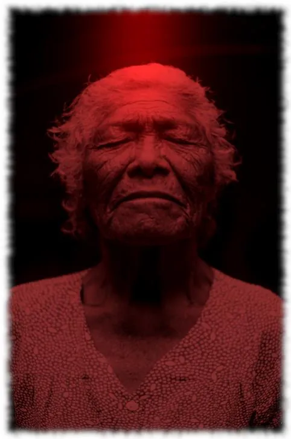

### Флоренс «Фло» Сандерс

Хотя на вид ей под восемьдесят, Флоренс «Фло» Сандерс на самом деле всего 21 год. Три года назад её отец, торговец древностями, уронил античную урну, разбил её и выпустил заключённого в ней духа, который за считаные секунды состарил отца на несколько тысяч лет. Затем дух перебил остальную семью Сандерс и исчез. Самой Сандерс удалось спрятаться, но одна лишь близость этой твари состарила её до нынешнего состояния. Потом никто не поверил, что Сандерс — та, за кого себя выдаёт; её ненадолго обвинили в убийстве собственной семьи, а затем отмахнулись от неё как от бродяжки. Сандерс осталась без крова и средств к существованию, пока её не заметила доктор Харпер и не приняла в институт «Дедал».

## Институт «Дедал»

После первого визита к доктору Эйнсли Харпер и нападения одной из её пациенток сыщики могут захотеть вернуться и подробнее осмотреть институт «Дедал». Для этого можно попросить экскурсию (её может провести персонал), выдать себя за возможного пациента (или даже лечь в институт в этом качестве) или прибегнуть к более скрытным способам.

### Устройство здания

Основной этаж института состоит из двух крыльев, в которые попадают через вестибюль. В одном крыле — комнаты пациентов, живущих в институте, комната персонала, а также кафетерий и маленькая кухня. В другом крыле — рекреация и зона отдыха. Доступ в остальную часть крыла закрыт электрической дверью с простым кодовым замком. Код знают все сотрудники, а также некоторые пациенты (в том числе все «маленькие факелы» доктора Харпер). За охраняемой дверью в крыле — смотровая, комната групповой терапии, комната размышлений и медитации, кабинет доктора Харпер и техническое помещение. Кроме того, на территории института есть сад камней, площадка для упражнений, открытый бассейн и тропы по окрестной глуши.

Обычные обитатели института, включая бо́льшую часть персонала, не знают, что институт продолжается под землёй. За запертой металлической крышкой в полу технического помещения скрыт туннель, который ведёт к водопроводу здания, но спускается и дальше — в цепь природных пещер, где живут «постоянные жильцы» института.

### Западное крыло и вестибюль

- **(1) Вестибюль.** Длинная изогнутая стойка тянется почти через весь вестибюль и обращена к стеклянным наружным стенам. Канцелярские принадлежности лежат во встроенных в стену ящиках, которые выдвигаются от нажатия. Здесь в любое время суток дежурит медсестра или санитар. Незапертая дверь ведёт в западное крыло, а дверь с кодовым замком — в восточное. Открытые проёмы ведут в кафетерий в западном крыле и в рекреацию в восточном.
- **(2) Кафетерий.** В кафетерии пять круглых столов; к нему примыкают маленькая кухня и кладовая, где санитар готовит еду. Ещё столы и стулья стоят снаружи, за смежными стеклянными дверями.
- **(3) Пустые комнаты пациентов.** Всего комнат восемь. Каждая обставлена просто: минималистичные картины, кровать, стол, стул, шкаф и санузел. Сейчас заняты только две (см. ниже).
- **(4) Комната Флоренс «Фло» Сандерс.** Комната Сандерс во многом похожа на комнату девочки-подростка, и сыщики, побывавшие в комнате Кэти Белл, могут заметить внешнее сходство между ними. На стенах приколото несколько плакатов с группами и музыкантами. К центру сердцевидного зеркала на стене приклеена фотография девочки-подростка. Проверка **Психологии** или **Идеи** подсказывает, что девочка на фото и Сандерс — родственницы (но не покажет, что на самом деле это один и тот же человек). По решению Хранителя на столе в этой комнате может лежать и модель головоломки, которую сыщики могли видеть на первом этаже Маяка (см. **часть III. Сны о Маяке — первый этаж**). Сыщики должны получить **раздатку 6. «Лестница»**, если поймут связь и поупражняются в решении головоломки Маяка на модели. Это можно сделать проверкой **Идеи** каждый час, пока над головоломкой бьются: сначала чрезвычайной, затем трудной, затем обычной.
