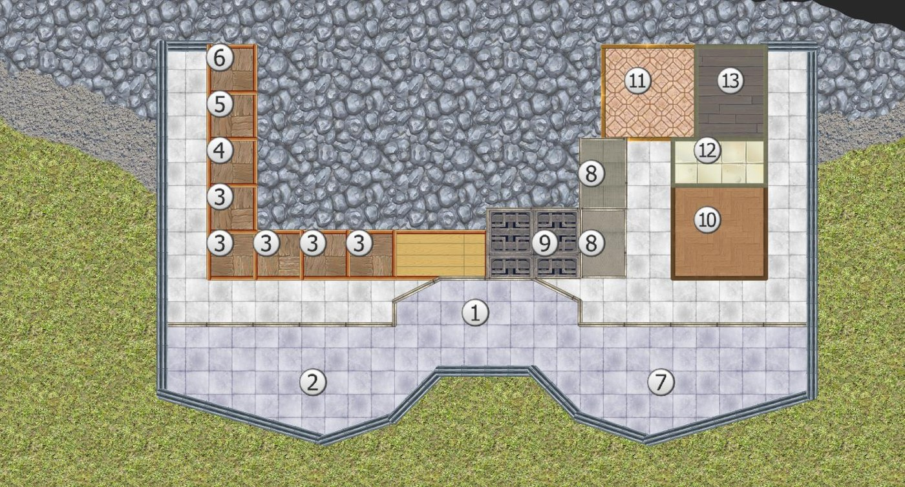

**Ключ к плану института «Дедал»**

| № | Помещение |
|---|---|
| 1 | Вестибюль |
| 2 | Кафетерий |
| 3 | Пустые комнаты пациентов |
| 4 | Комната Флоренс «Фло» Сандерс |
| 5 | Комната Саймона Чанса |
| 6 | Бывшая комната Кэти Белл |
| 7 | Рекреация |
| 8 | Уборные |
| 9 | Техническое помещение |
| 10 | Комната групповой терапии |
| 11 | Комната размышлений |
| 12 | Смотровая |
| 13 | Кабинет доктора Харпер |

*На плане подписаны только номера; названия помещений — по описанию на с. 19–20. Одна комната рядом с комнатами 3 на плане без номера и в описании не упомянута.*

### Под институтом

Скрытые комнаты «постоянных жильцов», куда можно попасть через запертую решётку в полу технического помещения или обыскав лесные тропы вокруг института, на самом деле — четыре соединённые природные пещеры. Когда сыщики входят из института, срабатывают датчики движения и включается неяркий свет.

- **Первая пещера.** Технический туннель под институтом упирается в проломленную кирпичную стену и выходит в открытую пещеру, где в скалу вделаны цепи и кандалы. Цепи покрыты густым вязким буроватым веществом; им же забрызганы пол и стены пещеры (**Рассудок** 0/1).
- **Вторая пещера.** В этой пещере стоит немного простой мебели и электрическая мини-кухня. Вся обстановка выглядит так, будто кто-то пытался играть здесь, под институтом, в дочки-матери. Все приборы в плохом состоянии. Рядом стоит неработающий генератор, а возле него — детская кроватка, на вид брошенная. Днём в этой комнате сидит семья упырей. Ночью семья уходит на поиски добычи.
- **Третья пещера.** Здесь несколько десятков электрических свечей: одни мерцают, другие уже погасли. Они окружают картину высотой больше двух метров (семь футов), на которой изображён раскрытый в крике рот. На картине нарисован человек, который словно пытается выползти изо рта и из самой картины. В метре-другом перед картиной стоят металлическая тарелка с конфетами и энергетическими батончиками и бутылки с водой.
- **Четвёртая пещера.** В последней пещере — подземное природное озерцо, которое стекает в другие затопленные пещеры. Здесь живёт **Альберто** — несчастный на поздних стадиях превращения в глубоководного. Он попытается удержаться и не нападать на сыщиков, которые на него наткнутся, но больше его ничто не сдерживает, и он может не совладать с собой. Пещера тянется дальше и в итоге выходит в лес вокруг института.

### Персонал

Днём в институте работают две медсестры и три санитара. Ночью дежурят только одна медсестра и один санитар, хотя доктор Харпер, единственный штатный врач, часто задерживается в институте до позднего вечера. Раз в неделю приходит бригада уборщиков — убрать то, до чего не дошли руки у санитаров.

- **Дневная смена.** Медсёстры **Джессика** и **Дениз Энгел**, сёстры-близнецы, в большинстве дней помогают доктору Харпер ухаживать за пациентами. Они знают, что Харпер применяет непроверенные экспериментальные методы лечения, но не знают правды о её практике. Из трёх дневных санитаров **Джоэл Стьюдер** и **Коул Апсар** подозревают, что в институте происходит больше, чем говорит доктор Харпер. Однако у обоих уголовное прошлое, и место в институте они считают бесценным вторым шансом, который не смеют упустить. Последняя из санитаров, **Анита Гонсалес**, неофициальная старшая над санитарами, знает правду и даже помогала ухаживать за «постоянными жильцами» института. Она считает (и не без оснований), что доктор Харпер владеет магической силой, и благоговеет перед ней.
