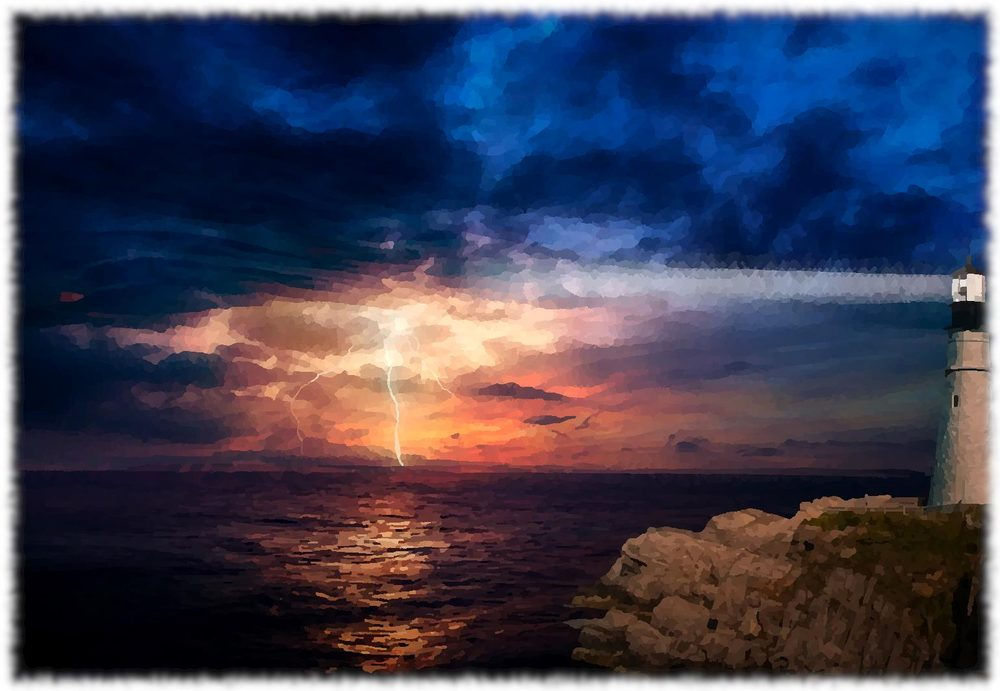

# Часть III. Сны о Маяке

> *С горящего корабля, откуда никак*  
> *Не спастись от пламени, кроме как в волнах,*  
> *Иные прыгали — и, к вражьим судам подплывая,*  
> *Гибли под выстрелами врага;*  
> *Так все пропали, кто на корабле был найден:*  
> *Те в море сгорели, те в горящем корабле утонули.*
>
> — Джон Донн, «Сгоревший корабль» (A Burnt Ship)

Часть III описывает, что бывает, когда сыщики заглядывают в Киносуру. Сыщики начнут видеть череду снов о Маяке, которая в конце концов приведёт к схватке с доктором Эйнсли Харпер. Когда сыщик впервые заглянет в Киносуру, он станет **отмеченным Ктугхой** (см. **«Киносура» — «Отмеченный Ктугхой»**). Он получит также **раздатку 8. «Снаружи»**. После этого — заглянув ли в Киносуру или просто заснув — он раз в день будет попадать в сновидческий мир Киносуры и продолжать с той части Маяка, где остановился в прошлый раз. Проходя разные части Маяка, сыщики будут собирать улики, которые помогут остановить Харпер и её пациентов. Пройдя все части Маяка, сыщики получат и возможность погасить искру Ктугхи в Киносуре, сделав артефакт инертным и завершив расследование.

**Раздатка 8. «Снаружи»**, **раздатка 9. «Первый этаж»** и **раздатка 10. «Башня»** представляют разные части Маяка и предлагают сыщикам цепочку выборов в духе книги-игры «выбери себе приключение». Неверный выбор, как правило, означает, что сыщик снова становится **отмеченным Ктугхой** или теряет **Рассудок**, а верный позволяет сыщикам продвинуться дальше в глубь Маяка. Сыщики могут также найти сокращения пути, которые облегчают продвижение по Маяку. Это **раздатка 5. «Путь»**, **раздатка 6. «Лестница»** и **раздатка 7. «Конец»**. За исключением последнего сна, который составляет кульминацию расследования, сыщики всегда видят сны поодиночке. Им не следует позволять согласовывать действия, пока они не проснутся, — тогда они смогут сравнить впечатления. Каждый сновидец должен встретить свой сон и его последствия в одиночку.

