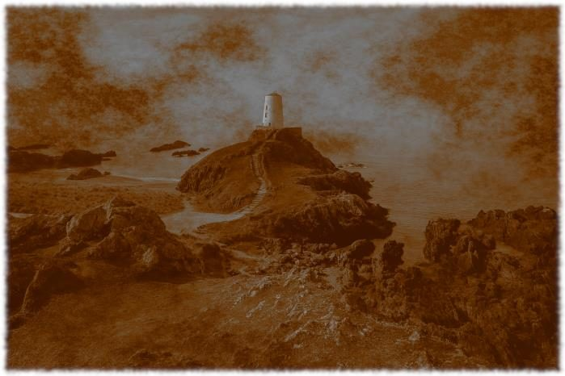
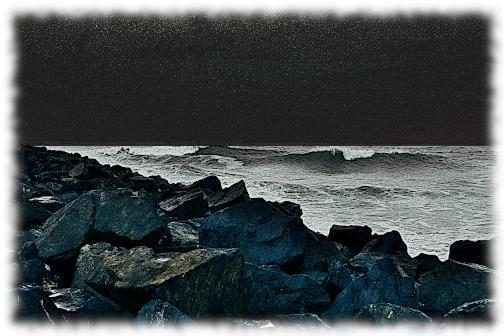

## Снаружи

Впервые попав в сновидческий мир внутри Киносуры, сыщики получают **раздатку 8. «Снаружи»**. Сыщики должны тайно сообщить Хранителю свой выбор из вариантов, перечисленных в раздатке. Сыщики продолжают попадать в сновидческий мир «Снаружи», пока не откроют **раздатку 5. «Путь»** и не доберутся до **раздатки 9. «Первый этаж»**. С этого момента сыщики, попадающие в сновидческий мир, начинают там.

> **Раздатка 8. «Снаружи»**
>
> *Ты стоишь один на скалистом берегу. Над тобой мерцает тысячами звёзд чёрное небо. Пока ты смотришь, они начинают гаснуть, одна за другой. Вокруг тебя валуны размером с дом сдерживают такие же огромные волны. Впереди, одна на утёсе над чёрным морем, стоит башня. Свет на её вершине не вращается, а бросает луч над водой, во тьму. Двери у подножия Маяка не видно, но дорожка из плоских камней спускается в расщелину в скале. Из проёма льётся оранжевое сияние. Тебе одиноко.*
>
> *Тайно сообщи Хранителю, какой путь ты выбираешь. И если ты впервые оказался «Снаружи», расскажи всем о моменте в жизни твоего сыщика, когда он почувствовал себя по-настоящему одиноким, и об обстоятельствах этого момента.*
>
> - ***Идти вдоль берега*** *по острым скалам к подножию Маяка.*
> - ***Идти к Свету*** *по дорожке из плоских камней в расщелину, к сиянию.*
> - ***Войти во тьму:*** *спуститься в расщелину, но держаться подальше от Света.*

Когда все сыщики, находящиеся «Снаружи», сделают выбор, Хранителю следует открыто рассказать о последствиях выбора каждого сыщика. Примечание: если сыщики не делились сведениями, можно вместо этого сообщить каждому сыщику его судьбу наедине.

### Идти вдоль берега

> *Ты идёшь вдоль берега. Шум волн о скалы оглушает. Вдруг волны обрушиваются на тебя: один из валунов срывается с места. Вода утаскивает тебя за собой, прочь от берега и от Маяка. Тебя тянет всё глубже, лёгкие наполняются водой, и ты начинаешь тонуть. Последнее, что ты видишь, — как перед тобой открывается исполинский глаз. Ты просыпаешься.*

Сыщики, увидевшие этот кошмар, просыпаются и теряют **Рассудок** (1d3/1d6).

### Идти к Свету

> *Ты входишь в большую пещеру, в которой парит одинокий огненный шар. Он движется к тебе. Ты бежишь?*

Сыщики, пытающиеся бежать, должны пройти проверку **Уклонения**; прошедшие её просыпаются без отрицательных последствий. Сыщики, проваливающие проверку, перед пробуждением испытывают ощущение, будто их сжигают заживо (**Рассудок** 1/1d3). Сыщики, не пытающиеся бежать, просыпаются с ощущением тепла в груди. Они становятся **отмеченными Ктугхой** и получают **раздатку 5. «Путь»**.

### Войти во тьму

> *Ты избегаешь Света и пробираешься тёмными местами по лабиринту пещер и туннелей.*

Сыщики, у которых есть **раздатка 5. «Путь»**, выходят на первый этаж Маяка и просыпаются. Остальные сыщики должны пройти чрезвычайную проверку **Археологии**, **Ориентирования** или **Естествознания**. Если сыщик проходит её, он получает **раздатку 5. «Путь»**, выходит на первый этаж Маяка и просыпается.
