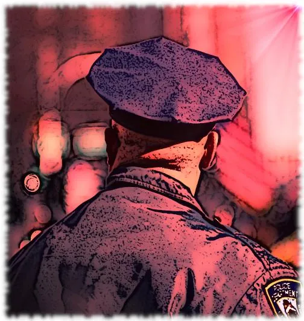

### Дверь полицейской машины — офицер Харлем Бэнкс

> *Ты сидишь на водительском месте полицейской машины. Из зеркала заднего вида на тебя смотрят чужие глаза: один тёмно-серый, другой молочно-белый. На тебе форма полицейского из местного участка. Лицо небрито. В бардачке на приборной панели лежит какая-то шкатулка-головоломка, похожая на ту, что в Маяке. К пассажирскому сиденью прислонён дробовик. На пассажирском сиденье раскрыта карта. Позади тебя задние сиденья заставлены ярко-оранжевыми пластиковыми канистрами. На каждой крупно отпечатано: «Осторожно: огнеопасно». Лицо в зеркале часто моргает, и ты просыпаешься.*

Пройдя через дверь полицейской машины, сыщики оказываются лицом к лицу с офицером **Харлемом Бэнксом**, одним из бывших пациентов доктора Харпер. Сыщики могли уже встретить Бэнкса во время пожара в колледже Кроули или знать его через знакомых в местной полиции. Бэнкс страдает клинической депрессией и склонен к самоубийству — отчасти из-за повседневных психологических травм своей профессии, отчасти из-за повторяющихся встреч с силами и сущностями, которые он не может объяснить, и прежде всего из-за того, что он увидел, участвуя в штурме усадьбы «Камелия» во время спасения Кэти Белл.

Проснувшись после этого видения, сыщики могут задаться рядом вопросов о сне — прежде всего, кто такой Бэнкс и куда он едет. Задав нужные вопросы и добившись обычного успеха в проверках навыков ниже, сыщики могут узнать следующее.

- **Внимание.** Успешная проверка **Внимания** позволяет прочесть имя полицейского на нашивке формы: «Харлем Бэнкс».
- **Юриспруденция.** Успешная проверка **Юриспруденции** по тому, что видно в машине, позволяет определить конкретный участок полицейского и где он служит.
- **Ориентирование, Выживание или Естествознание.** Обычный успех показывает, что Бэнкс смотрел на карту окрестностей, самая заметная точка на которой — усадьба «Камелия».
- **Красноречие.** Сыщики могут воспользоваться подсказками из видения, чтобы собрать больше сведений в местном полицейском участке. Проверка **Красноречия** позволит опознать Бэнкса по описанию. Трудный или чрезвычайный успех откроет к тому же, что он работал на складе (в оружейной участка), но, похоже, внезапно ушёл.

Сыщики, которые догадаются или выяснят, куда едет Бэнкс, могут попытаться перехватить его в усадьбе «Камелия». Бэнкс приедет вскоре после наступления темноты и оставит машину поодаль. Если сыщики его не остановят, Харлем расставит канистры с бензином вокруг старого особняка и подожжёт их, когда соберётся достаточно членов недавно возникшей колонии художников. Когда они побегут через узкий проход, который он нарочно оставил открытым, Бэнкс откроет огонь из набора оружия, взятого из оружейной участка.

Если сыщики окажутся не в том месте не в то время, Бэнкс может открыть огонь и по ним. Образумить Бэнкса нельзя: он зашёл слишком далеко и убеждён, что этот «культ» необходимо уничтожить. Единственная ненасильственная стратегия, у которой есть шансы на успех, — убедить его, что доктор Харпер его отзывает (**Красноречие**). Иначе сыщикам придётся обезвредить его силой. Если Бэнкс в какой-то момент будет ранен, он сожжёт себя и призовёт 1d3 огненных вампира. Если его убьют раньше, чем он успеет это сделать, его тело всё равно вспыхнет, но огненных вампиров не призовёт. Сыщики, видевшие самосожжение Бэнкса, могут также получить **раздатку 7. «Конец»**.

Если сыщики не вмешаются, в официальных отчётах о происшествии будет сказано, что Бэнкс выехал на пожар в поместье и застал поджигателей на месте преступления. Если Бэнкс погиб, по официальной версии событий он погиб либо при задержании поджигателей, либо пытаясь спасти людей, оказавшихся в доме.

Если после этих событий (видели их сыщики или нет) сыщики откроют дверь полицейской машины на первом этаже, они обнаружат, что дверь горячая на ощупь, и, открыв её, станут **отмеченными Ктугхой** и проснутся.

### Дверь с граффити — Саймон Чанс

> *Ты входишь в тёмный коридор, который словно растягивает твоё собственное тело, пока тянется дальше. Пол под ногами тёплый и кожистый, а стены туннеля твердеют и приобретают цвет тусклой слоновой кости. Сквозь щели, похожие на занозы, пробивается свет. Сквозь тонкую плёнку ткани ты видишь хаотическое месиво граффити и туалетную кабинку. В унитазе — непереваренные остатки последней трапезы и клубок извивающихся червей, похожих на угрей. «Уже пора?» — спрашивает голос, который, кажется, звучит отовсюду.*
