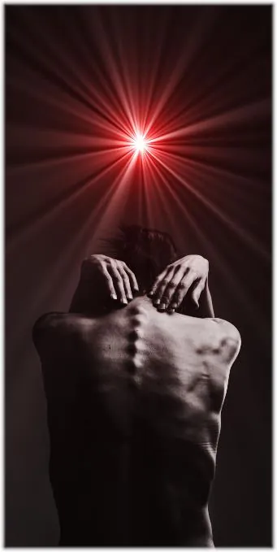

Сыщики, вошедшие в дверь с граффити, встречают **Саймона Чанса**, одного из пациентов, живущих в институте доктора Харпер. Чанс — бывший профессиональный танцовщик, чья погоня за физическим совершенством подорвала его здоровье: сначала расстройства пищевого поведения, а затем экспериментальные препараты, которые на деле оказались потусторонними паразитами, начавшими пожирать его внутренние органы. Карьера окончена, здоровье угасает, и Чанс лечится в институте «Дедал». Когда его там нет, он ходит по клубам — там он и находится, когда сыщики встречают его, исследуя Маяк.

Сыщики, испытавшие описанное выше, должны пройти проверку **Рассудка** (0/1), после чего у них есть возможность недолго поговорить с Чансом, прежде чем проснуться. Чанс удивится, услышав сыщиков. Он не скажет, где находится, но проявит к сыщикам искренний интерес. Себя он считает пропащим, но верит в Харпер и в то, что у него есть шанс вознестись в иное состояние бытия, если он сумеет забрать с собой в костёр, который станет его последним танцем, достаточно других людей.

> *Вы не устали ничего не значить? Быть никому не нужными во Вселенной, которой глубоко безразлично, живы вы или мертвы? Неужели вам не хочется хоть раз ярко вспыхнуть?*
>
> — Саймон Чанс

Если сыщики потом снова откроют дверь Чанса, прочтите следующее:

> *Яркие вспышки фиолетовых и синих стробоскопов слепят тебя, тебя крутит и вертит в толпе людей. Клубная музыка оглушает. «Это всё, чего я когда-либо хотел», — слышишь ты чей-то голос и чувствуешь, как тебе становится неприятно жарко.*

У сыщиков есть узкое окно, чтобы попытаться отговорить Чанса от исполнения плана — сжечь себя и устроить пожар, который (с помощью призванных огненных вампиров) погубит десятки посетителей клуба. Переубедить Чанса будет трудно: вернее всего подорвать его веру в Харпер и умолять его ограничить разрушение лишь собой, а не губить тех, кто вокруг.

Однако сыщикам придётся быть готовыми к тому, что Чанс в ответ поставит под сомнение их собственные побуждения и то, какой цели, по их мнению, они служат. Если Чанс всё же сожжёт себя, сыщики могут получить **раздатку 7. «Конец»**.

