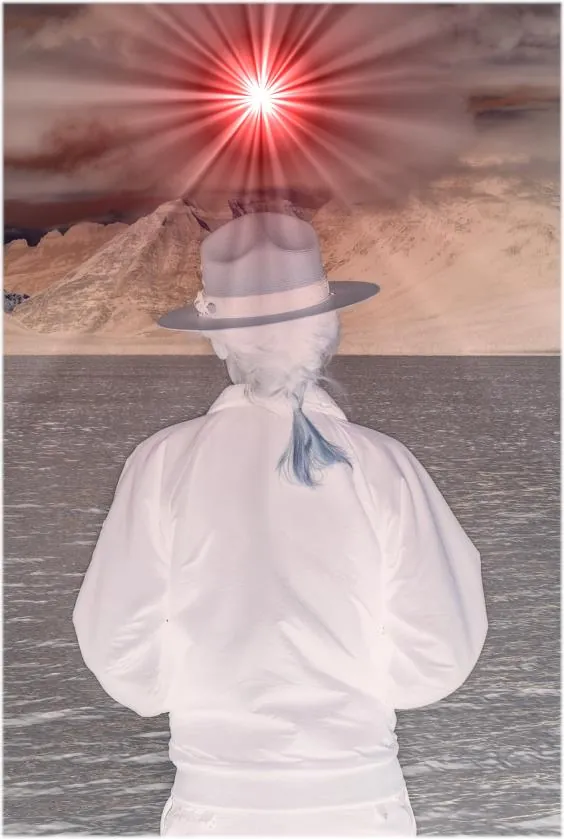

### Дверь бревенчатой хижины — Дана Кроуфорд

> *Ты входишь в бревенчатую хижину. Внутри движется тень; она обретает облик человека, остановившись перед зеркалом. Усталая женщина средних лет с серьёзным выражением лица застёгивает бежевую форму. На нашивке в зеркале задом наперёд написано: «Кроуфорд». Рядом с зеркалом висит листовка: сложный вихрь пёстрых символов, реклама какого-то фестиваля. Женщина тяжело вздыхает. В одной руке у неё деревянная головоломка, похожая на ту, что в Маяке. В другой — фляжка. Женщина отходит от зеркала, снова становится тенью и уходит. Ты просыпаешься.*

Сыщики, прошедшие через дверь бревенчатой хижины, встречают **Дану Кроуфорд**, рейнджера парков штата. Кроуфорд — алкоголичка; её зависимость усилилась после того, как три года назад она спасла двух туристов от тёмной молоди — порождения Шуб-Ниггурат. Терапия у доктора Харпер помогла ей обуздать алкоголизм, но страшной ценой. Теперь Кроуфорд готова пожертвовать собой, напав на неоязыческий фестиваль, который она считает сборищем поклонников Шуб-Ниггурат.

Поговорить с Кроуфорд у сыщиков возможности нет, но они могут задать ряд вопросов (и пройти подходящие проверки навыков), чтобы узнать: форма Кроуфорд — это форма рейнджера парков штата (**Юриспруденция**); листовка — реклама неоязыческого фестиваля «Собрание листьев», который проходит в округе в ближайшие несколько дней (**Оккультизм**); и Кроуфорд направляется сделать то, после чего не рассчитывает уйти живой (**Психология**).

У сыщиков будет всего день или около того, чтобы добраться до фестиваля и не дать Кроуфорд спалить его дотла вместе с участниками. Кроуфорд воспользовалась властью, которую даёт ей форма, чтобы попасть на фестиваль. По краю кемпинга она разложила горючие вещества. Она собирается устроить вокруг кемпинга огненное кольцо, заперев внутри как можно больше участников фестиваля, а затем поджечь себя и выпустить живущих в ней огненных вампиров.

Сыщики, приехавшие на фестиваль после того, как вошли в дверь бревенчатой хижины, должны найти Кроуфорд, облитую бензином, в тот миг, когда она вот-вот зажжёт фальшфейер, чтобы поджечь себя и кемпинг. Сыщики могут попытаться обезвредить её встречной проверкой **Ближнего боя (драка)** или обычным успехом проверки **Стрельбы**. Сыщики могут также попытаться отговорить её от выбранного пути подходящими социальными навыками (скорее всего, **Запугиванием** или **Убеждением**, но, возможно, и **Красноречием** или даже **Обаянием** — смотря как сыщики подойдут к Кроуфорд); сложность зависит от того, как сыщики к ней подступятся. Кроуфорд убеждена, что из-за возраста и алкоголизма её жизнь, по сути, кончена. Сыщики, разубеждающие её — хотя бы на миг, нужный, чтобы отнять у неё фальшфейер, — могут попытаться заставить её понять, что она вот-вот совершит массовое убийство или что доктор Харпер — обманщица (или по крайней мере не заботится о её благе).

Как бы сыщики ни обезвредили Кроуфорд, обыскав её (или её останки), они найдут копию головоломки из Маяка. Если сыщики увидят, как Кроуфорд сжигает себя, они могут также получить **раздатку 7. «Конец»**.

### Обычная дверь — Флоренс «Фло» Сандерс

Куда ведёт дверь, связанная с Флоренс «Фло» Сандерс, зависит от того, встречали ли её уже сыщики в начале **части II («Полуночный визит»)**. Если нет, Хранитель может зачитать следующее:

> *Ты шагаешь в дверь и оказываешься сидящим посреди комнаты. Над тобой витражный потолочный фонарь пропускает солнечный свет и заливает комнату каскадом красок. Каждая из картин, висящих на трёх стенах вокруг тебя, изображает абстрактный узор-лабиринт. Ты понимаешь, что все узоры на самом деле одинаковы и повторяют путь через пещеры под Маяком. Это озарение тебя будит.*

Сыщики, которые ещё не замечали сходства между частями института «Дедал» и лабиринтом, должны пройти проверку **Рассудка** (0/1).

Если Сандерс уже приходила к сыщикам и вспыхнула, Хранитель может вместо этого зачитать следующее:

> *Подходя к двери, ты чувствуешь жар, исходящий из-за неё. Ты слишком поздно отворачиваешься: дверь взрывается тебе навстречу, обдаёт тебя пламенем и поджигает твою кожу. Ты просыпаешься.*
