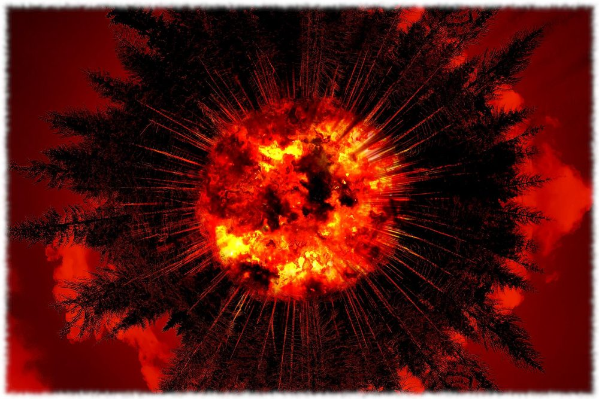

Сыщики, увидевшие этот кошмар, должны пройти проверку **Рассудка** (0/1) и становятся **отмеченными Ктугхой**.

### Решить головоломку

Чтобы выбраться с первого этажа, сыщикам нужно решить головоломку в центре зала. Пытаясь это сделать, сыщики могут пройти проверку **Идеи**. В первую попытку решить головоломку нужен чрезвычайный успех. Если он выпал, сыщик получает **раздатку 6. «Лестница»** и просыпается. В следующий раз, попав в сновидческий мир, он начнёт в «Башне». При провале каменная головоломка раскаляется, и из неё вырывается огненный шар, который настигает сыщика и обжигает его. Сыщик становится **отмеченным Ктугхой** и просыпается. В следующий раз, когда тот же сыщик возьмётся за головоломку, ему хватит трудного успеха в проверке **Идеи**.

Провал, однако, приводит к тому же исходу — и сыщик снова становится **отмеченным Ктугхой**. Сыщики, нашедшие копию головоломки (в комнате Саймона Чанса или Флоренс Сандерс в институте «Дедал», в кабинете доктора Харпер, в хижине Даны Кроуфорд, в полицейской машине Харлема Бэнкса или, возможно, в Маяке усадьбы «Камелия»), могут каждый час делать проверку **Идеи**, как описано выше. Решив копию, они поймут, что головоломку можно сложить в форму винтовой лестницы. Они получат **раздатку 6. «Лестница»**, после чего смогут решить головоломку на первом этаже и сразу же начать исследовать «Башню».

