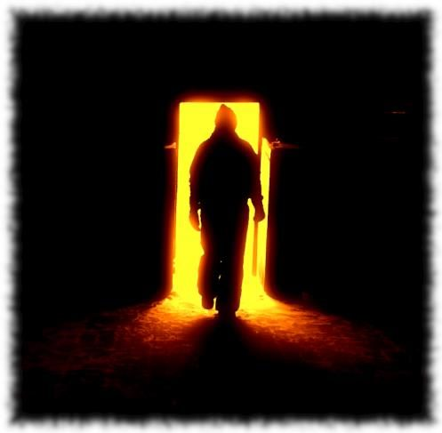

## Башня

Сыщики, получившие **раздатку 6. «Лестница»**, в следующий раз, когда им приснится Маяк, перейдут к **раздатке 10. «Башня»**.

> **Раздатка 10. «Башня»**
>
> *Ты в Башне, на узкой лестнице, что вьётся вверх. Ты поднимаешься, обходя Башню по кругу. Потом снова, и снова, и снова. Ты всё проходишь одно и то же окно, выходящее на чёрное море и надвигающуюся грозу. Каждый раз, когда ты выглядываешь, гроза ближе. И в то же время ты понимаешь, что ты не один. За тобой следует светящееся пламя, как у факела, сгоревшего до рукояти. Пламя идёт за тобой вверх по лестнице, а гроза всё приближается.*
>
> *Если ты впервые оказался в «Башне», расскажи всем о моменте в жизни твоего персонажа, когда казалось, что лучше уже не станет, когда любой выбор был плохим и надежды не было. Затем тайно сообщи Хранителю свой выбор:*
>
> - ***Море.***
> - ***Пламя.***
> - ***Бежать дальше.***

Затем Хранитель может открыто зачитать или описать последствия выбора для всех сыщиков.

### Море

> *Ты выбираешь море. Ты встаёшь перед окном и ждёшь. Вскоре гроза настигает тебя. Сквозь окно льют потоки дождя, пока ты уже не можешь отличить, где море, а где дождь. Вода поднимается снизу. И вместе с ней из воды в окно лезет масса щупалец с шипами. Сначала одна рука, потом другая оторваны, а затем то, что от тебя осталось, раздавливает ложноножка. Ты просыпаешься.*

Сыщики, увидевшие этот кошмар, должны пройти проверку **Рассудка** (1d3/1d6).

### Пламя

> *Ты выбираешь пламя. Свет факела входит в тебя через живот. Оттуда его жар расходится наружу, раскаляя воздух в лёгких и вскипятив кровь в венах. Ты просыпаешься.*

Сыщики, увидевшие этот кошмар, должны пройти проверку **Рассудка** (1/1d3), становятся **отмеченными Ктугхой** и могут получить **раздатку 7. «Конец»**.

### Бежать дальше

> *Ты продолжаешь бежать вверх по лестнице. Ты не просыпаешься.*

Если сыщик открыл **раздатку 7. «Конец»**, он добирается до приставной лестницы, ведущей к люку, за которым ждёт Фонарный зал. Если сыщик не открыл Конец, он впадает в кому. Раз в день он может проходить проверку **МОЩ**. При обычном успехе он может пересмотреть своё прежнее решение и выбрать Море или Пламя — или бежать дальше. При трудном успехе сыщик просыпается. За каждый день в коме сыщик становится **отмеченным Ктугхой**, пока не получит **Конец**, собрав нужное число карточек. Однако, если пробыть в коме дольше дня-двух, понадобится медицинская помощь, чтобы избежать других неприятных последствий. Если когда-нибудь в коме окажутся все сыщики, они откроют **Конец** и все вместе отправятся в Фонарный зал. Любой сыщик, находящийся в коме, когда другие сыщики достигают Фонарного зала, автоматически присоединяется к ним.

## Фонарный зал

Достижение Фонарного зала — кульминация расследования. Фонарный зал должен стать доступным, когда сыщики получат **раздатку 7. «Конец»**. В отличие от прежних частей Маяка, с которыми сыщики сталкивались в одиночку, в Фонарном зале все видящие сон сыщики окажутся вместе. Хранитель, желающий собрать сыщиков вместе, может отправить в кому тех, кто первым достиг Фонарного зала, пока к ним не присоединятся остальные. Или же Хранитель может позволить участвовать всем сыщикам, понимая, что сыщик, которого иначе здесь не было бы, присутствует лишь как сновидческое проявление остальных сыщиков (а значит, позже не будет помнить событий в Фонарном зале, но и не будет терять **Рассудок**). Этот подход позволяет также сыщикам, погибшим или впавшим в неизлечимое безумие, вновь присоединиться к остальным ради развязки.

Поднявшись по лестнице, ведущей из «Башни», сыщики достигают вершины Маяка. Однако Фонарный зал больше не замкнут: он лопнул наружу, будто от взрыва, и открыт ночному небу. Вода чёрного моря поднялась до Маяка и теперь простирается во все стороны, как океан.
