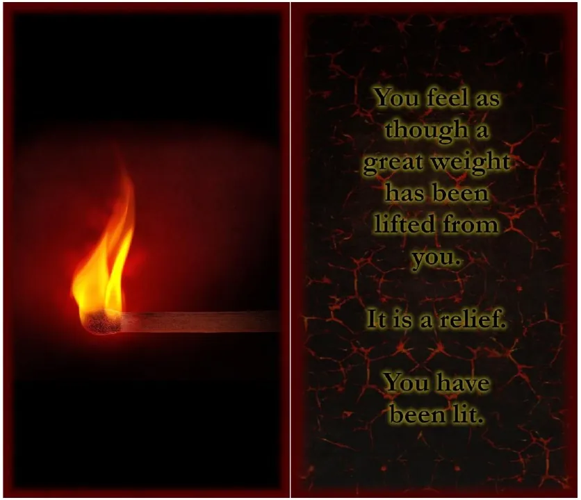

# Приложение B. Раздатка

*Ниже — каждая раздатка в оригинале (картинкой, для печати) и её перевод. Карточки 1–4 «Отмеченный Ктугхой» — двусторонние: слева картинка, справа текст; карточки 5–7 складываются пополам (надпись на нижней половине перевёрнута).*

## Раздатка 1. Отмеченный Ктугхой: «Зажжён»

> **Раздатка 1. Отмеченный Ктугхой: «Зажжён»**
>
> *Тебе кажется, будто с тебя сняли огромную тяжесть.*
>
> *Какое облегчение.*
>
> *Ты зажжён.*
